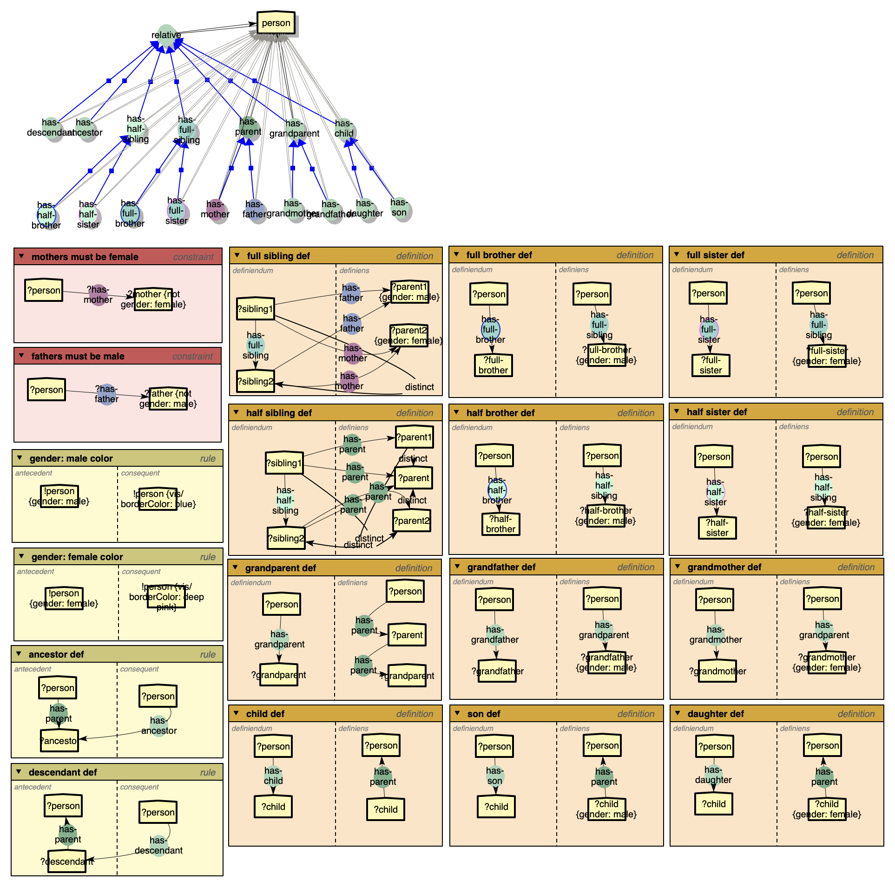
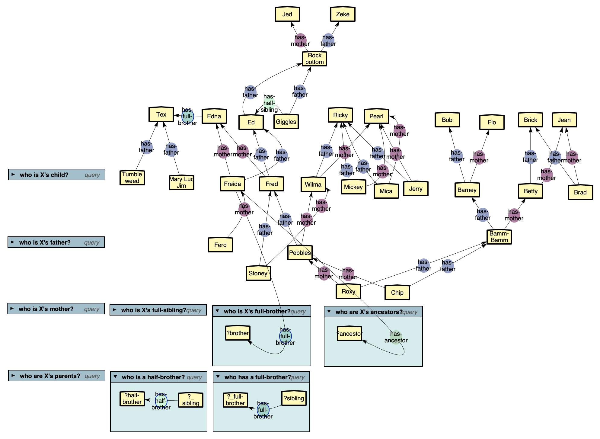
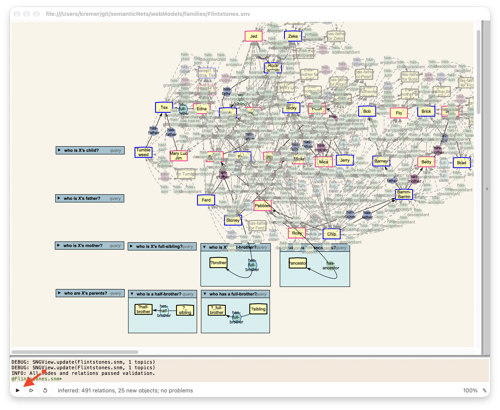
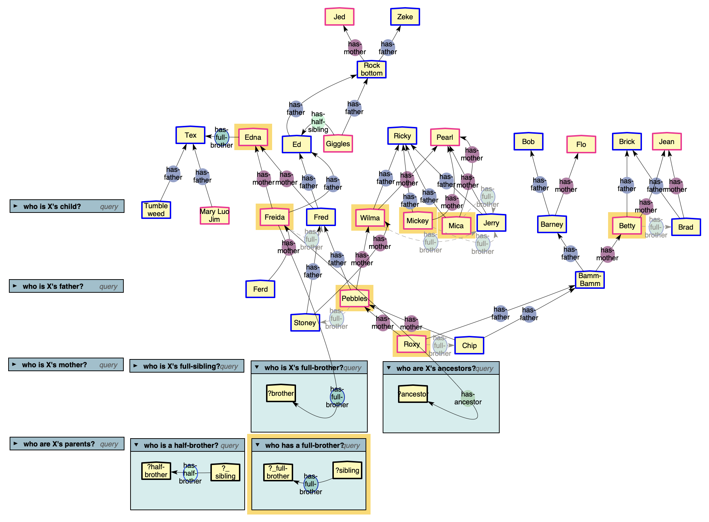

Families Models
===============

The families models show both an ontology and a concrete model that uses that
ontology. The ontology demonstrates types, contraints, rules, and 
definitions.  The Flintstones family tree demonstrates concrete relations among
individuals, queries, and the use or supermodels (the onotolgy).

Family Ontology
---------------

	
An ontology model for families, constraining genders of mothers and fathers, and 
defining ancestors, descendents, full- and half- siblings, brothers, and sisters,
grandparents, and children. This model demonstrates constraints, rules, and
definitions.

Model: `https://robkremer.github.io/semanticNets/models/families/familyOntology.snm <https://robkremer.github.io/semanticNets/models/families/familyOntology.snm>`__
    
View: `https://robkremer.github.io/semanticNets/models/families/familyOntology.snv <https://robkremer.github.io/semanticNets/models/families/familyOntology.snv>`__

The Flintstones Family Tree
---------------------------

	
A model of the Flintstone family (and friends) from the cartoon from 
Hanna-Barbera Productions, together with a number of example queries. This model
inherits from it's supermodel, *familyOnotology.snm*, above, so all the node types,
relations types, constraints, rules, and definitions apply here as well. 

Model: `https://robkremer.github.io/semanticNets/models/families/Flintstones.snm <https://robkremer.github.io/semanticNets/models/families/Flintstones.snm>`__
    
View: `https://robkremer.github.io/semanticNets/models/families/Flintstones.snv <https://robkremer.github.io/semanticNets/models/families/Flintstones.snv>`__
  

	
The figure above shows the same family tree with the reasoner invoked (using
the solid botton in lower left corner) to display all it can conclude on the
data in the view.  A bit much.

	
The figure above demonstrates a much more reasonable way to use the reasoner:
a query.  This query answers the question "Who has a full brother?", and the
reasoner highlights all the individuals who have a full bother and draws in
(faded) the inferred "has-brother" relations if they were not already explicitly
there. The reasoner as concluded the has-brother relations by virtue of having
two common parents.
