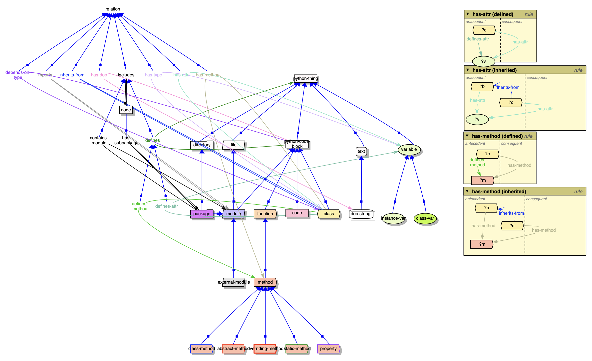
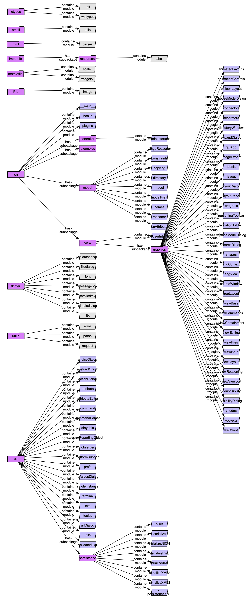
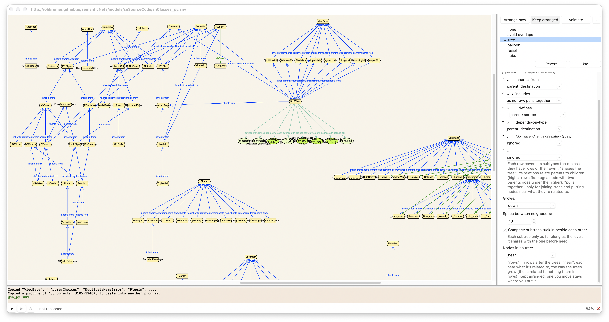
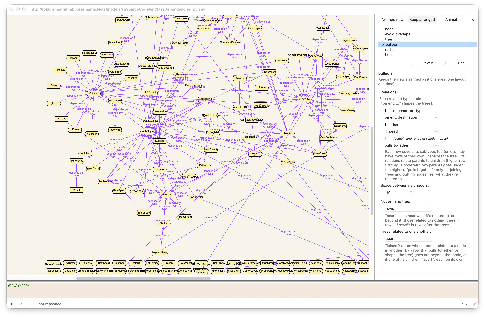

Semantic Nets Source Code Model
===============================

This model is generated by the *pythonParser* plugin from the *sn* package and
the *pythonUtils* package, ie: *sn's* own source code. The model contains
26,379 nodes and relations, so it's not practical to view the whole model in
on view.

The Python Ontology
-------------------
The plugin depends on pythonOntology.snm, and parses python modules or packages
according to that ontology. 

Model: `https://robkremer.github.io/semanticNets/models/snSourceCode/pythonOntology.snm <https://robkremer.github.io/semanticNets/models/snSourceCode/pythonOntology.snm>`__

View: `https://robkremer.github.io/semanticNets/models/snSourceCode/pythonOntology.snv <https://robkremer.github.io/semanticNets/models/snSourceCode/pythonOntology.snv>`__

	
The SemanticNets Source Code Parse
----------------------------------

Model: `https://robkremer.github.io/semanticNets/models/snSourceCode/sn_py.snm <https://robkremer.github.io/semanticNets/models/snSourceCode/sn_py.snm>`__

View: `https://robkremer.github.io/semanticNets/models/snSourceCode/sn_py.snv <https://robkremer.github.io/semanticNets/models/snSourceCode/sn_py.snv>`__

	
The above figure shows the top-level view of the model, showing only packages and
modules.  It could be expanded down to functions and classes, and then to methods
and object attributes.
	
View: `https://robkremer.github.io/semanticNets/models/snSourceCode/snClasses_py.snv <https://robkremer.github.io/semanticNets/models/snSourceCode/snClasses_py.snv>`__

	
The above figure shows classes and their inheritance relationships (as well as
one class's attribures expanded).
	
View: `https://robkremer.github.io/semanticNets/models/snSourceCode/snClassDependencies_py.snv <https://robkremer.github.io/semanticNets/models/snSourceCode/snClassDependencies_py.snv>`__

	  
The aove figure also shows classes, but instead of thier inheritiance, it shows
thier interdependencies. That is, classes that have other classes as type of thier
attributes.