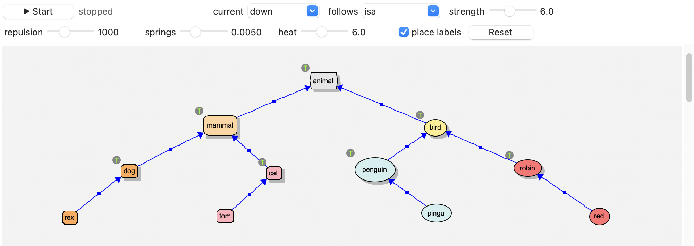

Animation Layout
================

The **animation layout** arranges a view for you, and you watch it happen.
(For layouts that arrange a view at once, or keep it arranged as it
changes, see :doc:`layouts`.)
It treats the drawing as a physical system: objects push one another apart,
like charged particles, and relations pull the objects they connect together,
like elastic bands. The objects move a little at a time until things settle
down, and then it stops by itself.

Start it from **view | layout | animate | start** on the background menu, or
with the play button on the animation toolbar. Start it again (or press the
button) to stop it early. A whole run is a single command: **Cmd-Z** puts
everything back where it was.

What moves
----------

Nodes, context windows and relation types are moved. Individual relations
aren't: their labels float midway between their ends. Hidden objects stay
where they are, and what's inside a context window moves with the window.

You can drag things while it runs -- the layout waits until you've let go,
then works around where you've put them.

The current
-----------

Without a current, the layout only spreads things out evenly. A **current**
gives it a direction: it lines up the relations of one type, putting their
destinations *upstream* of their sources, in layers. With *isa* and a current
flowing *down*, you get a class diagram: each type above its subtypes and
instances. With a relation like *manages*, flowing *right*, an organization
chart on its side.

   The animation toolbar, and a small taxonomy laid out with an isa current flowing down.

The current can flow in eight directions (down, up, left, right, and the
diagonals), or none. It runs in phases, shown on the toolbar:

**arranging**
  The current sorts things into layers. Objects in different layers can pass
  one another, so that a tree drawn upside down can turn itself over.

**settling**
  Things slow down -- the *temperature*, **T**, how far an object may move in a
  step, falls -- until nothing moves much.

**straightening**
  The layers are lined up.

At the very end, relation labels are tidied up.

The toolbar
-----------

**View | Animation toolbar** (in the menu bar) shows a toolbar above the
canvas, with the layout's controls. Hover over any of them for a description.

==============  ==========================================================
control         does
==============  ==========================================================
play            start or stop the layout
status          what it's doing (see above), and its temperature, T
current         the current's direction, or *none*
follows         the relation type the current lines up (by default, *isa*)
strength        how hard the current pulls things into their layers
repulsion       how strongly objects push one another apart
springs         how strongly relations pull their ends together
heat            random jiggling (with a current), which fades as the layout
                settles. It shakes the layout out of dead ends; more heat is
                livelier, but takes longer to settle
cooling         how fast it cools: how much of T it loses each time it stops
                making progress (30% by default). Slide it left for a long
                run -- at 0.1%, with a current, an hour or so
leaps           the chance, in a step, that an object stuck away from what
                it's related to (eg: behind a wall of other objects) jumps
                right across to land beside it -- like tunnelling. The more
                stretched its relations, the likelier it is to go. Leaps fade
                as the layout cools; 0% (the default) for none. The status
                shows how many there have been
place labels    whether a run ends by finding free places for the relations'
                labels (which can take a while in a crowded view). Ticked
                between runs, it places them straight away; ticked during a
                run, at the end of the run
Reset           put the sliders back to their defaults
==============  ==========================================================

Changes take effect immediately, even while it runs. The current's settings
are also on the **view | layout | animate** menu (**current direction**,
**current strength**, **current follows**). They're saved with the view, as
are the sliders and **place labels**.

Tips
----

- If things end up too crowded, raise **repulsion**; if they drift too far
  apart, raise **springs**.
- If a tree won't turn the right way up, raise **heat** a little and run it
  again.
- If parts of the graph get stuck behind others, far from what they're
  related to, raise **leaps** (eg: to 5--10%), and run it again.
- For a big or tangled view, slide **cooling** to the left and leave it to
  run (eg: while you get a coffee): the longer it stays warm, the more it
  explores before it settles. Press the button to stop it whenever you like.
- Running it again from where it stopped usually improves things further.
  Untick **place labels** while you do, and tick it again at the end: the
  labels are only placed once.
- Before laying out a big model, hide what you don't need to see (eg: the
  *isa individuals*, or *system objects*): see :doc:`viewing`.
