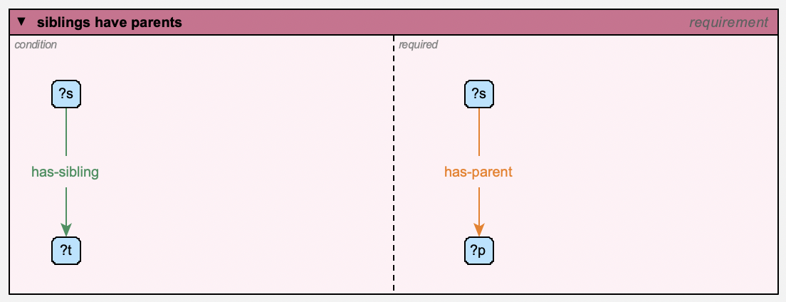

Contexts: Rules, Definitions, Queries, Constraints and Requirements
====================================================================

A **context** is a node that *contains* other objects: a little network of its
own, standing for a pattern rather than for facts about the world. The system
model defines five kinds:

===============  ============================================================
kind             what its contents mean
===============  ============================================================
**query**        a pattern to look for: "find everything that matches this"
**rule**         an *antecedent* and a *consequent*: "whenever the
                 antecedent matches, conclude the consequent"
**definition**   a *definiendum* and a *definiens*: "the one means exactly the
                 other" -- a rule that works both ways
**constraint**   a pattern that must *not* match: "each match is a problem"
**requirement**  a *condition* and what's *required*: "wherever the
                 condition matches, the required part must hold too" -- a
                 kind of constraint
===============  ============================================================

(*context* itself is the general kind: a context that's none of these simply
contains things.)

To make one, use **model | new instance of Node** on the background menu and
choose *query*, *rule*, *definition*, *constraint* or *requirement* (or a
subtype of one of them).

Context windows
---------------

A context is drawn as a **window**: a box with a title bar, holding the
objects it contains.

- The **title bar** shows the context's name and, in italics, its kind.
- A rule's window is split into two **panes**, *antecedent* on the left and
  *consequent* on the right; a definition's into *definiendum* and
  *definiens*; a requirement's into *condition* and *required*. A query, a
  constraint (or a plain context) has a single pane.
- The **triangle** at the left of the title bar collapses the window to its
  title bar (and expands it again). The contents of a collapsed window are
  hidden.
- Resize a window by dragging its corner handles, like any other object. Its
  contents stay put.
- Dragging the window carries its contents along with it.
- **Right-click in a pane** for the **new instance of / new subtype of**
  menus, as on the background: what you make goes where you clicked, in that
  pane (eg: into a rule's antecedent) -- so a rule can be edited in place.
  The window's own menu (answer query, gather, ...) is on its **title bar**.
  Relations drawn between things in a pane go in it too, and **make relation
  to...** picks what's under the pointer, in a window or not.
- **gather** (on the window's menu) brings in everything the context
  contains that isn't in its window -- each into the pane its containment
  says (antecedent, consequent, ...), and the variables its relations use
  along with them. Things just outside are nudged in; things from further
  away are set out in rows, with room for the labels of the relations
  between them. If there isn't room, the window grows. It's one command, so
  one undo puts everything back.

.. figure:: ../images/user/collapsed-window.png
   :alt: A collapsed window: just its title bar
   :width: 560px

   A collapsed window: just its title bar. Click the triangle to expand it again.

Containment is shown by position: the relations that say the window contains
an object (*contains*, *antecedent*, *consequent*, ...) aren't drawn for the
objects inside it.

Putting things into a window
----------------------------

- **Drag an object into a pane** to make the context contain it -- in that
  pane's role: dropped in a rule's antecedent pane, it's part of the
  antecedent. Dragging it into the other pane switches its role.
- **Drag it out** of the window to remove it from the context.
- A **relation** drawn between two objects, whose label lands in a pane, is
  contained in that pane too.
  A contained relation's label, while it floats (follows its ends), stays in
  its pane, even if one of its ends is moved outside the window. To take the
  relation out of the context, drag its label out.
- You can also say it explicitly: draw a *contains* (or *antecedent*,
  *consequent*, *definiendum*, *definiens*) relation from the window to an
  object. This is the way to put an object in *both* of a rule's panes, or to
  have a context contain something that stays outside its window (its arc is
  then drawn).

Windows can be nested: an object dropped where windows overlap goes into the
innermost one.

A window holds only what its context contains -- and the relations between
things it holds (eg: a pattern relation's isa link to its type variable),
which needn't be contained themselves. Anything else that ends up in it -- a window dropped or expanded over it, an object dropped half on its
edge, its containment removed -- is pushed out, the least way, onto a free
spot if there's one near (staying in its own pane, if it's in another
window). Of two windows dropped on each other (neither in the other), the
smaller is pushed off, carrying its contents. A relation's label that floats
between its ends keeps out of windows that don't contain it. This happens
when a change is made -- a drop, not while dragging -- and is undone with
it.

Variables
---------

Inside a context, an object whose name starts with ``?``, ``^`` or ``!`` is
a **variable**: it matches *any* object that fits everything the pattern says
about it. In a query ``?p -likes-> mary``, ``?p`` matches everyone who likes
mary.

Say what type a variable must be in the usual way -- an *isa* from the
variable to the type (*?p* isa *person*). A variable used in several places
must match the same object in all of them, so ``?x -has-parent-> ?y``, ``?y
-has-parent-> ?z`` matches grandchildren (``?x``) and their grandparents
(``?z``).

The first character of a variable's name says what it matches:

=========  ==========================================================
``?x``     an **individual variable**: matches individuals
``^T``     a **type variable**: matches types (so ``^T`` isa *animal*
           matches *dog*, *cat*, ...)
``!a``     an **"any" variable**: matches individuals and types alike
=========  ==========================================================

Make an individual variable an individual, and a type variable a type: the
name decides what it matches, but the reasoner warns about a mismatch (a
type named ``?x``, or an individual named ``^T``). A variable used as a
relation's type, eg: ``^r`` in ``!a -^r-> ?b``, matches relation types.

Objects in a pattern that *aren't* variables (*mary*, above) stand for
themselves.

.. _variable-constraints:

Constraints
-----------

A variable can also carry **constraints**: conditions on its attributes. They
are written as a comma-separated list:

==================  =========================================================
constraint          means
==================  =========================================================
``alive``           has the attribute *alive* (with any value)
``age: 30``         has *age* equal to 30. A value is a number, ``true`` or
                    ``false``, or text -- quoted (``'Big Al'``) if it has
                    commas, colons or quotes in it
``age: ?a``         has *age* equal to the value of every other constraint
                    that uses ``?a``
``symmetric``       (of a relation type) is tagged symmetric;
                    ``symmetric: false``: it isn't. Likewise *asymmetric*,
                    *reflexive*, *irreflexive* and *transitive*
``not ...``         the opposite of any of these: ``not alive``: doesn't
                    have *alive*; ``not gender: female``: doesn't have
                    *gender* equal to female
==================  =========================================================

A ``not`` is true of anything the model doesn't say otherwise about: ``not
gender: female`` matches something with no *gender* at all, as well as one
whose gender is something else. To leave out the ones with no gender, say it
has one, too: ``gender, not gender: female``. A key can have more than one
``not`` (``not colour: red, not colour: blue``), and a ``not`` with a value
variable (``not age: ?a``) needs the same variable used without ``not``
somewhere in the pattern, to give it its value.

You can type them with the variable's name when you make it, after
``:where:``:

.. code-block:: none

   ?p :where: alive, age: 30

They're stored in the variable's ``constraints`` attribute, which has its
own row in the attribute editor, where you can change it. (You can also type
``:where:`` and more constraints after the name in the *name* row: they're
added to the ones it has.) The label shows them in braces --
``?p {alive, age: 30}`` -- and a **{}** marker on the variable shows it has
constraints. If they can't be read, the marker is a red **{!}**: hover over it
to see why.

What constraints mean depends on where the variable is:

- in a query, a rule's antecedent or a definition, they're **tests**: the
  variable only matches objects that pass them;
- in a rule's consequent, they're **conclusions**: they're asserted about
  whatever the variable matched (eg: ``?x {status: 'grandparent'}``). A rule
  can't conclude that something *isn't* so, so a ``not`` there is reported as
  a problem when you reason.

Rules
-----

A rule says: whenever its antecedent matches, its consequent holds too. For
example, an *uncle* rule -- whoever has a parent with a brother has him as an
uncle:

- antecedent: ``?x -has-parent-> ?y``, ``?y -has-brother-> ?z``
- consequent: ``?x -has-uncle-> ?z``

.. figure:: ../images/user/rule-window.png
   :alt: The uncle rule

   The uncle rule. The consequent has its own ?x and ?z: variables with the same name are the same variable, wherever they are in the rule.

When you **reason** (see :doc:`reasoning`), the rule's conclusions are drawn
for every match in the model -- as relations, as attribute values (from the
consequent's constraints), and as types (an *isa* in the consequent concludes
that the matched object is of that type). Conclusions can feed other rules.

A variable that appears only in the consequent stands for a **new object**:
for each match, the reasoner concludes that some object exists that's related
as the consequent says -- unless the model already has one (related, and of
the types, the consequent says). Each is added to the model as an
**inferred** object, named for the variable and the match -- eg: "(m for
alice)" for ``?m`` in "everyone has a mother" -- with the types, attribute
values and relations the rule gives it, and shown (faded) beside what it's
related to in each view. Like other inferred objects (see :doc:`reasoning`)
it isn't saved, and **mark as asserted** in its menu makes it -- and the
relations the rule gave it -- an ordinary part of the model.

The reasoner reports rules it can't use, and why: a consequent relation with
no source or destination, or (in some cases) a variable it can't bind.

**show conclusions** (on a rule's menu) reasons if necessary, prints what the
rule concluded to the terminal, and highlights the objects it concluded
something about. **Esc** clears the highlights.

Definitions
-----------

A definition says the definiendum (the term being defined) and the definiens
(its meaning) are the same thing. Eg: *has-brother* -- someone's brother is a
sibling of theirs who's male:

- definiendum: ``?a -has-brother-> ?b``
- definiens: ``?a -has-sibling-> ?b``, ``?b {gender: male}``

.. figure:: ../images/user/definition-window.png
   :alt: A definition of brother (with ?a and ?b): a brother is a male sibling

   A definition of brother (with ?a and ?b): a brother is a male sibling. The {} marker shows that ?b has constraints.

It works both ways, as two rules:

- from the definiens: a sibling who's male is concluded to be a brother (in
  the family example: alice *has-sibling* bob, who's male, so alice
  *has-brother* bob -- and so, by the uncle rule, alice's child carol
  *has-uncle* bob);
- from the definiendum: from a *has-brother* relation, both the
  *has-sibling* relation and the brother's gender are concluded.

In the second direction, variables the definiendum doesn't mention are new
objects (eg: a *grandparent* relation defined through an intermediate
parent), and *distinct* relations (which only test that two variables match
different objects) are left out.

Queries
-------

**answer query** (on a query's menu -- or any context's, including a rule)
finds every match of the pattern, prints the answers (the value of each
variable, per match) to the terminal, and highlights the matched objects on
the canvas. **Esc** clears the highlights. Answers include what the reasoner
infers -- the model is reasoned over silently first, if it hasn't been (see
:doc:`reasoning`) -- and each one is shown, with the relations it matched,
even if it's in a hidden or erased category (eg: inferred objects).

.. figure:: ../images/user/query-answer.png
   :alt: Answering the query who likes dave?: the answer, carol, is highlighted, and printed in the terminal
   :width: 460px

   Answering the query who likes dave?: the answer, carol, is highlighted, and printed in the terminal.

.. _constraint-contexts:

Constraints
-----------

A **constraint** contains a pattern, as a query does, that the model must
*not* match: each match is reported as a problem when you reason (see
:doc:`reasoning`). Its attributes say how:

=============  ===============================================================
attribute      meaning
=============  ===============================================================
``code``       the problem's code (default: the constraint's name)
``severity``   ``error`` (the default) or ``warning``
``report``     what the problem is about, as a comma-separated list: its
               subject, then its arguments -- each one of the constraint's
               variables (eg: ``?x``) or a word taken as is. By default, all
               its variables, in name order.
``message``    the message, with ``{0}`` for the subject and ``{1}``, ``{2}``,
               ... for the arguments
=============  ===============================================================

Eg: every mother must be female -- a constraint containing ``?person
-has-mother-> ?mother``, with ``?mother {not gender: female}``, reports each
mother who isn't (or whose gender isn't known).

Or: a constraint containing ``?x -likes-> ?x``, with report ``?x`` and
message ``{0} likes themselves``, reports everyone who likes themselves. A
problem is reported once per set of objects it's about, so a constraint
matching both ``a -r-> b`` and ``b -r-> a`` reports a and b once.

Requirements
------------

A **requirement** says what must hold wherever something else does. Its
window has two panes, like a rule's: the **condition** on the left, and
what's **required** on the right. Where the condition matches and the
required part doesn't (for the same values of the variables they share),
that's a problem, reported when you reason. Variables with the same name are
the same variable, wherever they are in it, as in a rule.

Eg: every mother must be female:

- condition: ``?person -has-mother-> ?mother``
- required: ``?mother {gender: female}``

A rule with the same two parts would *conclude* that every mother is female
(and so that Fred is, if Barney -has-mother-> Fred). A requirement only
checks it, and reports Barney -has-mother-> Fred as a problem.

A variable only the required part has stands for "something": eg: with
condition ``?p`` (a person) and required ``?p -has-mother-> ?m``, everyone
must have a mother -- whoever she is. (A ``not`` can't say that: see
:ref:`variable-constraints`.) What the reasoner infers counts: a mother concluded by a
rule meets the requirement as well as one in the model.

The family example has one: whoever has a sibling must have a parent.

   The requirement *siblings have parents*: wherever ?s *has-sibling* ?t, ?s must *has-parent* someone (?p). It's a warning, reported against ?s with the message "{0} has a sibling, but no parent" -- and in the example, both alice and bob are reported: bob's sibling is given, and alice's is inferred (*has-sibling* is symmetric).

A requirement is a kind of constraint, with the same attributes (``code``,
``severity``, ``report`` and ``message``: see :ref:`constraint-contexts`) -- but
what it reports can only be the condition's variables: the required part's
own ones have no single value. A requirement with nothing in its required
pane is reported as a problem itself, as it can't be violated. (A variable
astride the divider is in both panes: its constraints are tests on what the
condition matches.)

The base rules
--------------

What the relational properties mean (symmetric, transitive, reflexive,
irreflexive, asymmetric) is itself written as rules and constraints, in a
model of **base rules** that comes with the program. Like the system model,
it's a super-model of every model -- read-only, always there, and not listed
in a model's preferences or saved with it. What they conclude is reported as plain inferences, not as rule
conclusions -- unless the ``reasoner/showSysRules`` preference is on, which
shows them as any rule's (for debugging the base rules).
