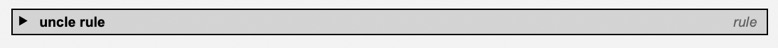
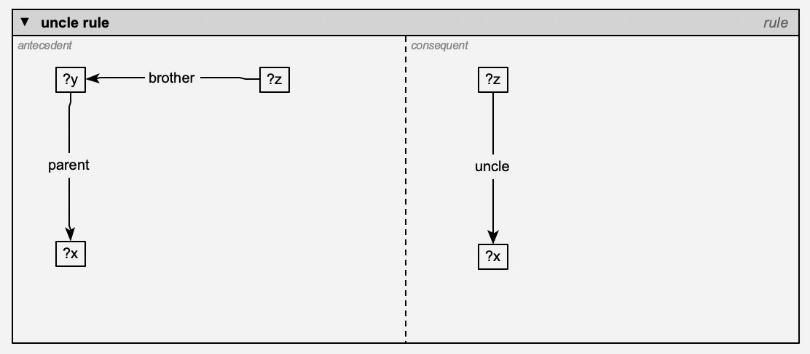
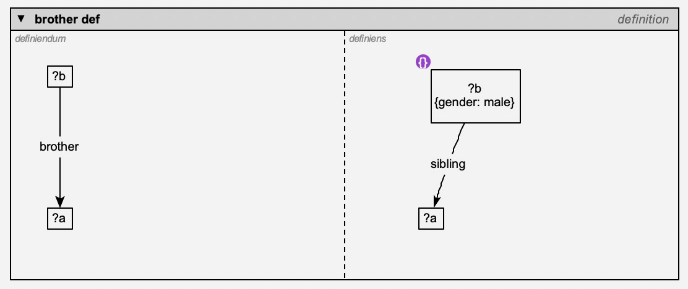
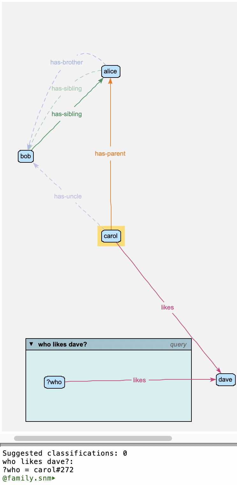

Contexts: Rules, Definitions, Queries and Constraints
=====================================================

A **context** is a node that *contains* other objects: a little network of its
own, standing for a pattern rather than for facts about the world. The system
model defines four kinds:

==============  ============================================================
kind            what its contents mean
==============  ============================================================
**query**       a pattern to look for: "find everything that matches this"
**rule**        an *antecedent* and a *consequent*: "whenever the
                antecedent matches, conclude the consequent"
**definition**  a *definiendum* and a *definiens*: "the one means exactly the
                other" -- a rule that works both ways
**constraint**  a pattern that must *not* match: "each match is a problem"
==============  ============================================================

(*context* itself is the general kind: a context that's none of these simply
contains things.)

To make one, use **model | new instance of Node** on the background menu and
choose *query*, *rule*, *definition* or *constraint* (or a subtype of one of
them).

Context windows
---------------

A context is drawn as a **window**: a box with a title bar, holding the
objects it contains.

- The **title bar** shows the context's name and, in italics, its kind.
- A rule's window is split into two **panes**, *antecedent* on the left and
  *consequent* on the right; a definition's into *definiendum* and
  *definiens*. A query (or a plain context) has a single pane.
- The **triangle** at the left of the title bar collapses the window to its
  title bar (and expands it again). The contents of a collapsed window are
  hidden.
- Resize a window by dragging its corner handles, like any other object. Its
  contents stay put.
- Dragging the window carries its contents along with it.

   A collapsed window: just its title bar. Click the triangle to expand it again.

Containment is shown by position: the relations that say the window contains
an object (*contains*, *antecedent*, *consequent*, ...) aren't drawn for the
objects inside it.

Putting things into a window
----------------------------

- **Drag an object into a pane** to make the context contain it -- in that
  pane's role: dropped in a rule's antecedent pane, it's part of the
  antecedent. Dragging it into the other pane switches its role.
- **Drag it out** of the window to remove it from the context.
- A **relation** drawn between two objects, whose label lands in a pane, is
  contained in that pane too.
- You can also say it explicitly: draw a *contains* (or *antecedent*,
  *consequent*, *definiendum*, *definiens*) relation from the window to an
  object. This is the way to put an object in *both* of a rule's panes, or to
  have a context contain something that stays outside its window (its arc is
  then drawn).

Windows can be nested: an object dropped where windows overlap goes into the
innermost one.

Variables
---------

Inside a context, an object whose name starts with ``?`` is a **variable**:
it matches *any* object that fits everything the pattern says about it. In a
query ``?p -likes-> mary``, ``?p`` matches everyone who likes mary.

Say what type a variable must be in the usual way -- an *isa* from the
variable to the type (*?p* isa *person*). A variable used in several places
must match the same object in all of them, so ``?x -has-parent-> ?y``, ``?y
-has-parent-> ?z`` matches grandchildren (``?x``) and their grandparents
(``?z``).

A variable matches individuals if it's an individual, and types if it's a
type. A variable whose name starts with ``!`` instead (eg: ``!x``) is an
**"any" variable**: it matches individuals and types alike. (A variable used
as a relation's type, eg: ``?r`` in ``!a -?r-> !b``, matches relation
types.)

Objects in a pattern that *aren't* variables (*mary*, above) stand for
themselves.

Constraints
-----------

A variable can also carry **constraints**: conditions on its attributes. They
are written as a comma-separated list:

==================  =========================================================
constraint          means
==================  =========================================================
``alive``           has the attribute *alive* (with any value)
``age: 30``         has *age* equal to 30. A value is a number, ``true`` or
                    ``false``, or text -- quoted (``'Big Al'``) if it has
                    commas, colons or quotes in it
``age: ?a``         has *age* equal to the value of every other constraint
                    that uses ``?a``
``symmetric``       (of a relation type) is tagged symmetric;
                    ``symmetric: false``: it isn't. Likewise *asymmetric*,
                    *reflexive*, *irreflexive* and *transitive*
==================  =========================================================

You can type them with the variable's name when you make it, after
``:where:``:

.. code-block:: none

   ?p :where: alive, age: 30

They're stored in the variable's ``constraints`` attribute, which has its
own row in the attribute editor, where you can change it. (You can also type
``:where:`` and more constraints after the name in the *name* row: they're
added to the ones it has.) The label shows them in braces --
``?p {alive, age: 30}`` -- and a **{}** marker on the variable shows it has
constraints. If they can't be read, the marker is a red **{!}**: hover over it
to see why.

What constraints mean depends on where the variable is:

- in a query, a rule's antecedent or a definition, they're **tests**: the
  variable only matches objects that pass them;
- in a rule's consequent, they're **conclusions**: they're asserted about
  whatever the variable matched (eg: ``?x {status: 'grandparent'}``).

Rules
-----

A rule says: whenever its antecedent matches, its consequent holds too. For
example, an *uncle* rule -- whoever has a parent with a brother has him as an
uncle:

- antecedent: ``?x -has-parent-> ?y``, ``?y -has-brother-> ?z``
- consequent: ``?x -has-uncle-> ?z``

   The uncle rule. The consequent has its own ?x and ?z: variables with the same name are the same variable, wherever they are in the rule.

When you **reason** (see :doc:`reasoning`), the rule's conclusions are drawn
for every match in the model -- as relations, as attribute values (from the
consequent's constraints), and as types (an *isa* in the consequent concludes
that the matched object is of that type). Conclusions can feed other rules.

A variable that appears only in the consequent stands for a **new object**:
for each match, the reasoner concludes that some object exists that's related
as the consequent says. (They're reported, and listed by **show
conclusions**, but not added to the model.)

The reasoner reports rules it can't use, and why: a consequent relation with
no source or destination, or (in some cases) a variable it can't bind.

**show conclusions** (on a rule's menu) reasons if necessary, prints what the
rule concluded to the terminal, and highlights the objects it concluded
something about. **Esc** clears the highlights.

Definitions
-----------

A definition says the definiendum (the term being defined) and the definiens
(its meaning) are the same thing. Eg: *has-brother* -- someone's brother is a
sibling of theirs who's male:

- definiendum: ``?a -has-brother-> ?b``
- definiens: ``?a -has-sibling-> ?b``, ``?b {gender: male}``

   A definition of brother (with ?a and ?b): a brother is a male sibling. The {} marker shows that ?b has constraints.

It works both ways, as two rules:

- from the definiens: a sibling who's male is concluded to be a brother (in
  the family example: alice *has-sibling* bob, who's male, so alice
  *has-brother* bob -- and so, by the uncle rule, alice's child carol
  *has-uncle* bob);
- from the definiendum: from a *has-brother* relation, both the
  *has-sibling* relation and the brother's gender are concluded.

In the second direction, variables the definiendum doesn't mention are new
objects (eg: a *grandparent* relation defined through an intermediate
parent), and *distinct* relations (which only test that two variables match
different objects) are left out.

Queries
-------

**answer query** (on a query's menu -- or any context's, including a rule)
finds every match of the pattern, prints the answers (the value of each
variable, per match) to the terminal, and highlights the matched objects on
the canvas. **Esc** clears the highlights.

   Answering the query who likes dave?: the answer, carol, is highlighted, and printed in the terminal.

Constraints
-----------

A **constraint** contains a pattern, as a query does, that the model must
*not* match: each match is reported as a problem when you reason (see
:doc:`reasoning`). Its attributes say how:

=============  ===============================================================
attribute      meaning
=============  ===============================================================
``code``       the problem's code (default: the constraint's name)
``severity``   ``error`` (the default) or ``warning``
``report``     what the problem is about, as a comma-separated list: its
               subject, then its arguments -- each one of the constraint's
               variables (eg: ``?x``) or a word taken as is. By default, all
               its variables, in name order.
``message``    the message, with ``{0}`` for the subject and ``{1}``, ``{2}``,
               ... for the arguments
=============  ===============================================================

Eg: a constraint containing ``?x -likes-> ?x``, with report ``?x`` and
message ``{0} likes themselves``, reports everyone who likes themselves. A
problem is reported once per set of objects it's about, so a constraint
matching both ``a -r-> b`` and ``b -r-> a`` reports a and b once.

The base rules
--------------

What the relational properties mean (symmetric, transitive, reflexive,
irreflexive, asymmetric) is itself written as rules and constraints, in a
model of **base rules** that comes with the program. Like the system model,
it's a super-model of every model -- read-only, always there, and not listed
in a model's preferences or saved with it. What they conclude is reported as plain inferences, not as rule
conclusions -- unless the ``reasoner/showSysRules`` preference is on, which
shows them as any rule's (for debugging the base rules).
