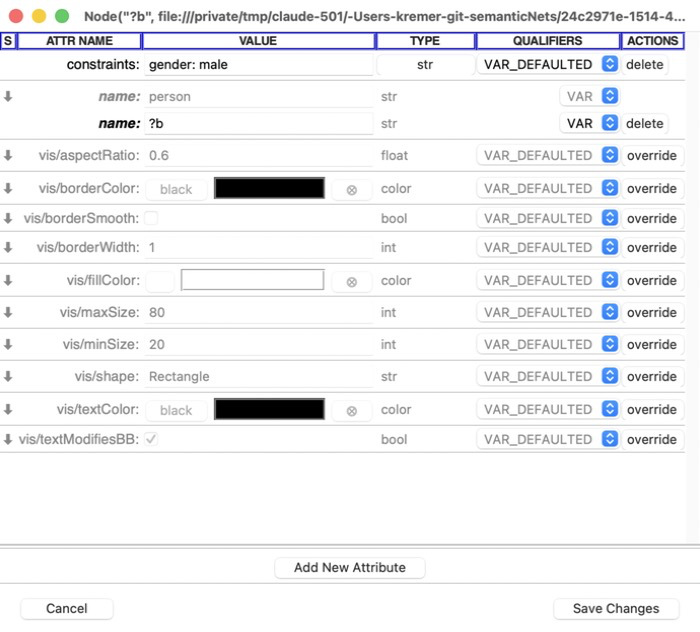

Editing
=======

Making objects
--------------

From the background menu, **model**:

- **new instance of Node** / **new subtype of Node** -- a new individual, or a
  new type, directly under *node*;
- **new instance of Relation** / **new subtype of Relation** -- likewise for
  relations (a new relation type is a new kind of relation, eg: *likes*).

From an object's menu: **make new instance** and **make new subtype** make an
individual of that type, or a subtype of it.

You're asked for the new object's name. (A variable's name can carry its
constraints: see :doc:`contexts`.)

Making relations
----------------

Right-click the source, and choose **make relation to...**: its submenu lists
the relation types you can use, the system model's and any other models' in
submenus of their own. Then a line follows the mouse from the source: click
the destination. Clicking empty space makes a relation with no destination of
its own (it's drawn to its type's range, faded, or left dangling). **Esc**
abandons it.

Relations can connect nodes and relations in any combination -- except *isa*,
which must be between two nodes or two relations.

To change a relation's source or destination, drag its end (the cursor
changes over it) onto another object; its menu also has **reset src** and
**reset dst**.

Selecting, moving and resizing
------------------------------

- **Click** an object to select it (**Shift**- or **Cmd**-click to add to the
  selection); click again to deselect.
- **Drag** to move it -- or, if it's selected, everything selected. When you
  drop it, it's nudged off anything it landed on.
- A selected object has handles at its corners: drag one to **resize** it.
  **fit to text** (in its menu) undoes manual sizing.
- A relation's label normally sits midway between its ends (*floating*);
  dragging it pins it where you put it. **floating** in its menu (or **view |
  float all relations**) puts it back between its ends.

Attributes
----------

**edit attributes** (in an object's menu) opens the attribute editor: one row
per attribute, with its value, type and inheritance rules, and the values it
inherits shown above it in grey. You can add attributes, change their values
and types, and delete them. Hover over a row's name for its description. A
value the reasoner inferred is greyed out too, marked **I** in the status
column: its **assert** button (then **Save Changes**) makes it an ordinary
value (see :doc:`reasoning`).

   The attribute editor, on the variable ?b: its constraints, its own name (with the name it would inherit, in grey, above), and -- grouped under *vis* -- the look it inherits from *person*: its colour and shape.

Removing things
---------------

An object's menu has two kinds of removal:

- **erase from view**: just stop showing it in this view (the model keeps it).
- **delete from model** (or **remove from model**): delete it from the model
  -- and so from every view of it.

Both can be undone.

Cut, copy and paste
-------------------

**Cmd-C** (**Edit | Copy**, or **copy** in an object's menu) copies what's
selected; **Cmd-X** (**cut**) copies it and deletes it from the model;
**Cmd-V** (**Edit | Paste**) pastes it, and **model | paste here** pastes it
where you clicked.

A view can't show an object twice, so copying is done in the *model*: pasting
makes **new** objects, copies of the ones you copied -- and they show in every
view of the model, as any new object does. In the window you paste in, they're
drawn as the originals were: the same sizes and layout, back where they were
(if that's clear -- eg: they were cut) or else beside them. They're left
selected, so you can drag them away at once. Paste again for another copy.

What's copied:

- the objects themselves, with their own attributes (not the ones they
  inherit), as they were when you copied them;
- everything a context (a rule, query, definition, ...) contains: copying a
  rule copies its antecedent and consequent too;
- each object's types (its isa links).

A copied relation whose end wasn't copied relates the same object, and a copy
of something whose type wasn't copied is another of that type. So copying a
couple of *has-brother* rules, pasting them, and changing the pasted relations
to *has-sister* (eg: with **reset dst** on their isa links) leaves the
originals as they were.

Since a copy refers to the objects around it (its types, and the ends of its
relations), you can paste into another model only if it builds on the one you
copied from (see **Edit | Model preferences...**): otherwise the paste is refused,
with a message. What the reasoner inferred isn't copied (mark it as asserted
first).

Cut and paste can be undone. In the terminal pane, **Cmd-C** and **Cmd-V**
copy and paste text, as usual.

Validation
----------

**model | validate** (or **validate** on an object) checks the model's
consistency. Objects with problems get a red **E** marker: hover over it for
the problems, or choose **show error report** from the object's menu.
