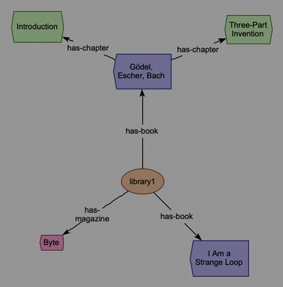
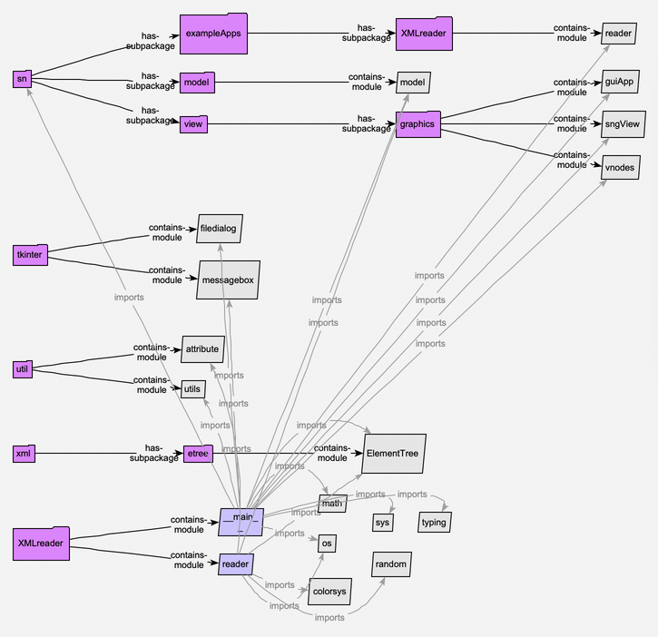

Plugins
=======

*Semantic Nets* can be the front end of other programs: a program makes a
model of something -- a file, a program, a database -- and opens a view of it
in the editor, where you can look round it, arrange it, ask about it and
reason over it as you would any model. Such a program can be a **plugin**:
it's loaded when the editor starts, and adds itself to the menu bar -- most
often to the **Tools** menu. Three come with *Semantic Nets*:

**Tools | XML Reader...**
  makes a model of an XML file (see `The XML reader`_).

**Tools | Python Parser...**
  makes a model of a Python program (see `The Python parser`_).

**Tools | Rep Plus Net Reader...**
  makes a model of a net drawn in Brian Gaines's Rep Plus (CNet, KNet) (see
  `The Rep Plus net reader`_).

They all save what they make as an ordinary model and view (``.snm`` and
``.snv``), so you can open them again later from **File | Open...** or the
model directory, like any other.

Where plugins are
-----------------

Each plugin is a folder in ``~/.sn/plugins/`` (beside the settings: see
:doc:`files`); **Help | Reveal Plugins Folder** opens it in the Finder.

- **The ones that come with it** are put there when the editor starts, if
  they aren't there yet -- or if the editor has a newer version of one (which
  replaces the copy there: so to change one, copy it to a folder of another
  name first).
- **Adding one**: put its folder there, and start the editor again. (A plugin
  is a folder with a *plugin.toml* in it, saying what it is: how one's made is
  in the Developer Guide, :doc:`../developer/extending`.)
- **Turning one off**: list its folder's name in the ``plugins/disabled``
  setting (**Settings...**), and start the editor again.
- **One that doesn't work** -- it's for a later version of *Semantic Nets*,
  or its code fails -- is left out, and the log says why; the rest of the
  editor, and the other plugins, carry on.

A plugin is a program: its code runs when the editor starts, and models may
call its functions (see `Menus, tooltips and double-clicks from programs`_).
Install only plugins you trust.

The XML reader
--------------

**Tools | XML Reader...** opens a dialog: the **XML file** to read (choose
one -- starting in the folder you read one from last, or, the first time, in
the plugin's *examples*), and the three files it makes of it. For
*books.xml*, they're *books_xml.snm* (the **model**: the elements),
*books_xml.snv* (the **view**) and *books_xml_ontology.snm* (the
**ontology**: the model's super-model, with the types and definitions -- the
place to change the type hierarchy, or add rules), next to it. Change any of
them, by typing or with **Choose...**: until you do, they follow the XML
file (and the view and ontology follow the model). (For the plugin's own
examples, they're made in ``~/Documents/Semantic Nets Examples/`` instead:
the plugin's folder is replaced when a newer version comes.) **Go** makes
them, asking first if the model or view is there already, and opens the
view.

What the file's tags and attributes *mean* is worked out from how they're
used throughout the file, not from their names (they're only hints), so it
works for XML of any kind:

- **Properties**: a tag with no tags inside it, that's never repeated in an
  element (a book's ``<title>``, say), is a property of the element it's in,
  not a thing of its own: the book gets a ``property/title`` attribute (see
  the attribute editor: :doc:`editing`). Its value is the tag's text -- or,
  if it has none, its one attribute (``<author name="Hofstadter"/>``). An
  element's own XML attributes are its properties too (``property/year``).
  Values that are all whole numbers, all numbers, or all true or false are
  stored as such.
- **Groups**: a tag that's never repeated, and holds only properties (a
  device's ``<States>``, say), adds them to its element:
  ``property/States/onOffState``.
- **Things**: every other tag -- one that holds other things, or is repeated
  (a book's ``<chapter>``\ s) -- becomes a type, with a colour and shape of its
  own, which its elements inherit, so you can see what each is; and each of
  its elements an individual of it.
- **Kinds**: if a tag's elements have a property whose name says it's a kind
  (it has *type*, *kind*, *category* or *class* in it), whose values are
  names that recur (``<book kind="novel">``), each is of a subtype named by
  it, in a shade of its tag's colour.
- **Names**: each is named by its *name*, *title*, *label*, *id* or *key*
  (the first it has), or by its text, if that's short; otherwise by its tag
  and a number (*chapter1*, *chapter2*, ...).
- **Annotations**: an attribute that says what a *tag* is, rather than what
  each element is -- one on many tags, always the same for each
  (``type="integer"`` on every ``<Address>``) -- isn't given to every
  element: it's noted on the type, or on the property it describes.
- **Nesting** becomes relations: a book's chapters are related to it by
  *has-chapter*. A tag that just holds a list of things (a ``<DeviceList>``
  of ``<Device>``\ s) isn't made: the element it's in has them, by
  *has-DeviceList*. Each of these is a kind of *xml-has-part*, so the whole
  tree is there whatever the tags. The ontology defines *xml-part-of* as the
  other way round ([?a -xml-part-of-> ?b] ⇔ [?b -xml-has-part-> ?a]):
  **reason** (see :doc:`reasoning`) concludes that each chapter is
  *xml-part-of* its book.
- **References**: a property named like a reference (ending in *id* or
  *ref*: ``<DeviceID>``), most of whose values are another element's *id*,
  is a relation to that element too, named for it (*DeviceID*): a kind of
  *xml-refers-to*.

Each type's **tooltip** lists its elements' properties: hover over one to
see them. (It's the type's ``vis/tooltip``: change it there.) The terminal
pane says what the tags were found to be.

**An ontology that's there already** is built on, not replaced: the dialog
says what it'll do with the one given. It may be one made before for the same
file (which you've changed since: moved types about, added types, attributes
or rules), or one shared by several XML files of the same kind -- choose it
for each, and their models are all built on it. (The dialog remembers the
ontology you chose: next time, it offers that one, if it's still there,
rather than one beside the model. Empty its field to go back to one beside
the model.) It can be a URL (eg: on the web) rather than a file. What's in it is found by name -- a tag's type by the
tag, wherever you've moved it in the type hierarchy; a subtype by its kind's
value, under its tag's type; *has-<tag>*, the references,
*xml-has-part*, *xml-part-of* and *xml-refers-to* by theirs -- and only
what's missing is added: a type, property or relation for something new in
the file, with a colour and shape of its own.

What it says also overrides what's worked out from the file: a tag that has
a type there is a thing, even if it would otherwise be a property (make one
for it, to have its elements as things of their own); and one that a type
there has a property for (``property/<tag>``) is a property.

- If the ontology can be changed (a file here that you can write), what's
  missing is added to it, and it's saved -- so the next file of that kind
  finds it there.
- If it can't (it's on the web, or a file you can't write), it's left as it
  is: the types and *has-<tag>* relations it hasn't go in the model instead
  (a new subtype of one of its types, too), and an attribute its types
  haven't is just in the elements.
- To start afresh, tick **Replace it**: a new ontology is made in its place.
  Anything you'd changed in it is lost, and other models built on it lose
  their types.

If you've renamed or deleted a type, it isn't found, so it's made afresh (as
for a new ontology), and the log says what was added. (If its *has-<tag>* is
still there, pointing to the renamed type, the log warns you: the reasoner
would say each of those elements is out of its range.) If *xml-part-of* is
missing, it's made again with its definition; if you've only deleted its
definition, that stays deleted.

The view shows the **types** (each tag's, and their subtypes), each with its
elements round it, arranged by the balloon layout (see :doc:`layouts`): the
types organize it. **Expand** an element (its menu's **expand**, or **expand
by relation...**) to bring in what it holds, what it's in, and what it refers
to. The types are still in the ontology: they're only shown in the view.

A big file -- more than 2000 elements -- would take minutes to show, and
make a crowded view. For one of those, the view shows just the types, as a
tree, each subtype below its type. **Expand** the ones you're interested in
to bring in their elements, and go on from there.

   What the XML reader makes of *books.xml* (in the plugin's *examples*:
   ``~/.sn/plugins/XMLreader/examples/``): a library with two books and a
   magazine.

The *examples* folder also has *library25.xml* and *library200.xml* (25 and
200 made-up books), to see how it copes with something bigger. Things to try:

- Hover over a book: its tooltip lists its properties -- its id, year,
  title and author (and in the library files, its kind and language).
- Right-click *library1*, and **expand all | 1 level**: it's related to the
  books by *has-book*, and to the magazine by *has-magazine*.
- **view | hide by category | relation types...**, and tick *has-chapter*:
  the lines to the chapters are hidden (untick it to show them again). In a
  file with references, hiding them (eg: *DeviceID*) leaves just the tree.

The Python parser
-----------------

**Tools | Python Parser...** makes a model of a Python program: its packages, modules, classes, functions
and methods, the classes' variables (and their types), their doc strings, and what imports what. It opens a dialog,
listing the files to analyse (a folder stands for all the ``.py`` files in
and below it: **Add files...** and **Add folder...** add more), with:

**Follow imports: n levels**
  How far to follow imports from them. 0 analyses just these files (what they
  import is shown, but not looked into); 1 also the modules they import; and
  so on.

**Analyse the standard library and installed packages too**
  Otherwise, imports from those are noted, but not looked into.

**Show imports in the view**
  Which *imports* relations to show: none, those of the files given, or all.

and **Go**.

It makes a model named after the program's main module, with ``_py`` (eg:
*XMLreader_py.snm* and *.snv*), next to it, built on an ontology of Python
programs that comes with it (*pythonOntology.snm*, in the plugin's folder: package, module, class,
function, method, ... and the relations between them). The view shows the
packages and modules, as trees growing right, by *includes* (see
:doc:`layouts`), and the imports asked for; the rest of the model is there to
be brought in. The view is *kept arranged* by that tree layout: **expand** a
module (**expand by relation... | defines →**, or **expand all**) and its tree
opens up for its classes and functions.

   What the Python parser makes of the XML reader's own code (imports not
   followed): its two modules, *reader* and *view*, and the modules they
   import, in their packages.

If the model and view are already there (eg: from an earlier run, before the
code changed), it asks what to do:

**Update**
  Bring the model up to date with the code: what's still there keeps its node
  -- and its id, so the views of the model (yours, and its own) still work --
  corrected (eg: its doc string, its lines); what's new is added; and what's
  gone from the code is removed from the model. Things are matched by their
  full dotted names (eg: *sn.model.model.Node.isa*): something renamed, or
  moved, is taken to be gone, and something else new. A view that showed
  something that's gone shows it as missing (its error report offers to
  **erase view object**). Its own view also shows the new packages and
  modules. Anything of your own in the model -- objects, and attributes you've
  added -- is left as it is (but a relation to something removed goes with
  it).

**Replace**
  Make them afresh.

**Cancel**
  Leave them as they are.

Its objects know where their code is:

- A module's, class's or function's menu has **Show source** (the code, in a
  window here, with its lines highlighted), **Open in editor** and **Reveal
  in Finder**.
- A class's or function's **tooltip** is its code (cut short if it's long:
  see ``gui/tooltipMaxLines`` in :doc:`files`).
- **Double-clicking** a class or function opens it in your editor.

The code is found in its file as it is *now*, by its name -- so it's still
found after the file's been edited. **Open in editor** uses the
``gui/editorCommand`` setting (**Settings...**): a command with ``{path}``
and ``{line}`` (and ``{url}``) in it, eg: ``code -g {path}:{line}`` for VS
Code, or ``bbedit +{line} {path}`` for BBEdit. (Hover over the setting for
more, eg: for Eclipse.) If it's empty, or can't be run, the code is shown in
a window here instead.

Things to try:

- Expand a module, then a class in it: *includes* covers *defines*,
  *defines-method* and *defines-attr*, so the tree goes on out to the class's
  methods and variables. A variable shows its type (eg: *nodes:list[Node]*),
  and *has-type* the classes in the model that names: a type that isn't one
  of them (eg: *int*, *list*) is just shown, not linked to.
- **Reason**: the ontology's rules conclude what each class *has-attr*: the
  variables it defines, and those it inherits (by *inherits-from*).
- **view | show | nodes...**, and tick *class*: all the classes, and how
  they're related (eg: *inherits-from*).
- **view | layout | arrange now | hubs**, with all the imports shown: the
  modules most imported, in the middle of their groups.

The Rep Plus net reader
-----------------------

**Tools | Rep Plus Net Reader...** opens a dialog: the **net file** to read
(a ``.rnet`` file, made by Rep Plus's CNet or KNet, in any of its versions:
6 to 9), and the **model** and **view** to make of it -- for *patterns.rnet*,
*patterns.snm* and *patterns.snv*, in the folder you last made them in (the
first time, next to the net). Change either, by typing or with
**Choose...**: until you do, they follow the net file (and the view follows
the model). **Go** makes them, asking first if they're there already, and
opens the view: the net as CNet drew it, each node where it was (half as big
again, as the editor's text is bigger), with its links between them.

What's in the net becomes:

- **Node types**: each of the net's node types (*Concept*, *Title*,
  *Note*, ...) becomes a type of the same name, with its shape and colours:
  the second of its four colours is its fill, the third its text's, and the
  fourth its outline. One that's just its text (a title, a note) has no
  outline or fill. A grid's node is a file folder. A type with Rep Plus's
  enclosure shape (*construct*, *frame*, *rules*, *cases*, ...) becomes a
  subtype of *context* that doesn't quote what it contains (see
  :doc:`contexts`): its nodes are boxes of facts.
- **Link types**: each of the net's link types (*Includes*, *Excludes*,
  *Coexcludes symmetric*, *Prefer*, ...) becomes a relation type of the same
  name, drawn as CNet draws it, with relation marks (see :doc:`viewing`):
  its arrowheads (heavy for a conjunction, double for a disjunction), the
  bars before them (one for an exclusion, two for a coexclusion, three for a
  negation), and a mark in the middle of a symmetric one -- in its colour,
  straight, with no label. A dashed one's colour is faded. It's a subtype of
  the KNet kernel's relation type that its look says it is (see `KNet's
  kernel`_): an arrow is *includes*, an arrow with one, two or three bars
  *excludes*, *coexcludes* or *negates* (a heavy or double arrowhead is still
  an arrow), a line with one, two or three bars across its middle the
  symmetric ones, and an arrow at each end (or a plain line named so)
  *equivalent*. Generic links, preferences, prohibitions and "Etc" links
  aren't. One drawn backwards -- its arrow at its tail, eg *Includes
  reverse* -- is turned round: its arrow is at its destination, and its
  links go the other way, so it means what it shows.
- **Nodes**: each node is an individual of its type, named by its label (a
  node with no label has no name). Pictures and drawings in the net are left
  out.
- **Marks**: a node's mark (true, false, or both) is its ``mark`` attribute
  (``T``, ``F`` or ``TF``), with the kind of mark (``markKind``: *Asserted*,
  *Included*, *Excluded*, ...), whether it was derived (``markDerived``), and
  the number the file has (``marks``). It's drawn as Rep Plus draws it: the
  node filled with the mark kind's background colour, and its outline in
  the kind's colour, if the mark says so -- and its label adds the mark (its
  type's ``vis/label`` is ``$name${mark:+ $mark}``). An asserted mark is
  also the node's truth mark, which the reasoners propagate (see `Truth
  marks`_).
- **Links**: each link is a relation of its type. A line with a second type
  (CNet draws two lines side by side) is a link and a link back: the second
  type's relation goes from the link's destination to its source. Any
  numbers it carries (eg: a weight) are its ``values`` attribute. Derived
  links (CNet's or KNet's inferences, their types named so: eg *Includes
  derived*) are made as they are.
- **Boxes**: a node of an enclosure type is drawn as a window, the size CNet
  drew it, and contains (by *contains* relations) the nodes inside it -- each
  in the smallest box it's in, so boxes can be nested. As in CNet, dragging
  a box carries what's in it.
- **Constructs**: the poles in a *construct* box (the nodes it contains)
  exclude each other, as CNet's construct macro says, unless an includes
  link (or a chain of them) joins them. Each such pair gets a *construct
  excludes* relation, a subtype of the net's own symmetric exclusion, faded
  as derived links are: hide them, or take them out, by that type.
- **Groups** aren't made: in Rep Plus they're only a way to select and drag
  nodes together, and mean nothing.

The terminal pane says what was made, and anything in the file that didn't
fit (eg: a link to a node that isn't there).

KNet's kernel
~~~~~~~~~~~~~

The models the reader makes build on the plugin's *knet.snm* (made by
``tools/makeKnetRules.py``): the kernel of Brian Gaines's protologic
(*Universal Logic as a Science of Patterns*, 2015), as relation types and
rules that every reasoner engine applies. X *includes* Y means whatever is X
is Y (dog includes animal):

==================  =========================================================
relation type       means
==================  =========================================================
*includes*          whatever is X is Y. Transitive.
*equivalent*        X and Y include each other (a subtype of *includes*).
                    Symmetric.
*excludes*          nothing is both. Symmetric.
*coexcludes*        everything is one or the other. Symmetric.
*negates*           X is everything Y isn't (a subtype of *excludes* and
                    *coexcludes*). Symmetric.
*inconsistent*      X both includes and excludes Y: X can only be empty (a
                    subtype of *includes* and *excludes*).
==================  =========================================================

Its rules are Gaines's inference patterns: whatever includes the tail of an
exclusion excludes its head; whatever excludes the head of a coexclusion
includes its tail; a coexclusion is inherited by what its tail includes; an
exclusion and a coexclusion together are a negation (so two negations of
one node are equivalent); a cycle of inclusions makes its nodes equivalent;
and including what it excludes makes a node inconsistent -- a warning, not
an error: the inconsistency stays where it is. **Reason** (see
:doc:`reasoning`) draws KNet's conclusions over the net: on the inference
pattern nets of Gaines's paper, they're the derived links KNet saved.

A view leaves out the inferences that say what it already shows (the kernel
types' ``vis/hideImplied``: see :doc:`viewing`) -- a node's loop to itself,
a symmetric one again the other way round, an *includes* beside an
*equivalent* -- else they'd swamp the picture.

The kernel works in models of your own too: build one on *knet.snm* (see
:doc:`files`). Between types, an isa link is an inclusion if the types are
under *knode*: dog isa animal isa knode gives dog *includes* animal, so a
type that *excludes* animal excludes dog.

Truth marks
~~~~~~~~~~~

Gaines marks a node true (a vertical bar beside it: there's something it
stands for) or false (a horizontal bar over it: it's empty), or both
(Belnap's "both": inconsistent). A KNet node -- an instance of *knode*, as
the reader's nodes are -- shows its marks as those bars, in Rep Plus's
colours for how it got them:

================  ===========  ==================================================
how               colour       why
================  ===========  ==================================================
asserted          brown        it's marked so (in the net's file, or by you)
included          black        true: something true includes it
coexcluded        blue         true: it coexcludes something false
excluded          green        false: it excludes something true
irrelevant        grey         false: it includes something false (Rep Plus's name)
necessary         red          false because it's inconsistent (it excludes
                               itself) -- or true because it coexcludes itself
================  ===========  ==================================================

A node's menu has **Mark** ▸ **True**, **False** and **Clear** (for the
selected nodes, undone in one go); **Reason** propagates the marks (reason
again after changing them). The marks are two attributes,
``markTrue`` and ``markFalse``, whose values say how (eg: ``asserted``): the
reasoners' are inferred values, and an asserted one always stands. A net's
file's asserted marks are asserted ones; the marks KNet propagated (and saved)
are left to the reasoners -- the file's look of them, its fill and outline,
stays. On KNet's net of the paper's figure, the reasoners mark exactly the
nodes KNet did.

The bars are a view feature anything can use: a node's ``vis/sideBars`` (see
:doc:`viewing`).

Not yet: the structural connectives (heavy and double arrowheads: their
"for every defining link" clause, and the marks through them), preferences
and defaults, and probes. And KNet can treat nodes with the same label as
one node (when its script says so); the reader keeps them apart.

Menus, tooltips and double-clicks from programs
-----------------------------------------------

The pythonParser's menu items, tooltips and double-clicks aren't built
into the editor: its model's types *name* functions of the pythonParser's,
in attributes (eg: ``.menu/Show source``), so they still work when the model
is saved and opened again later. Opening such a model runs that program's
code, so it's done only for the programs *Semantic Nets* trusts: its own,
the plugins it has loaded, and those listed in the ``hooks/trustedModules``
setting. An item naming a function of any other is
shown, but greyed out, and the log says why. (How a program does this is in
the Developer Guide: :doc:`../developer/extending`.)
