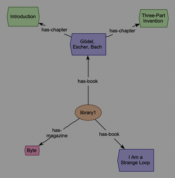
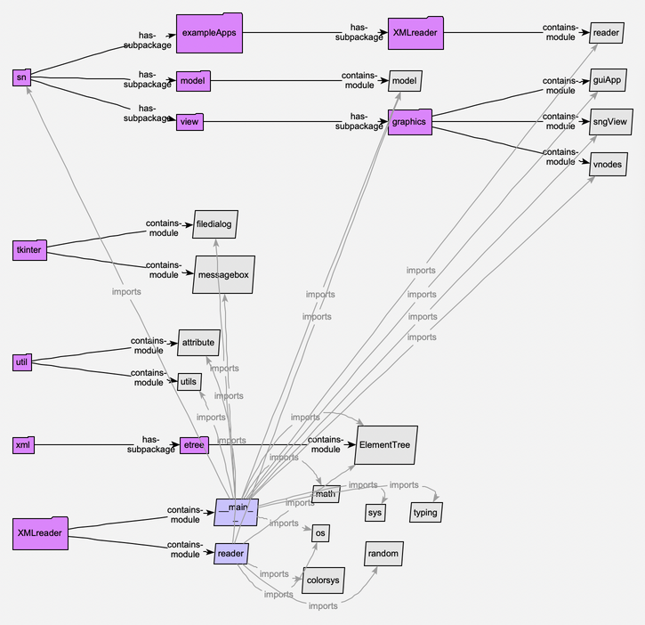

Plugins
=======

*Semantic Nets* can be the front end of other programs: a program makes a
model of something -- a file, a program, a database -- and opens a view of it
in the editor, where you can look round it, arrange it, ask about it and
reason over it as you would any model. Such a program can be a **plugin**:
it's loaded when the editor starts, and adds itself to the menu bar -- most
often to the **Tools** menu. Two come with *Semantic Nets*, as examples:

**Tools | XML Reader...**
  makes a model of an XML file (see `The XML reader`_).

**Tools | Python Parser...**
  makes a model of a Python program (see `The Python parser`_).

Both save what they make as an ordinary model and view (``.snm`` and
``.snv``), so you can open them again later from **File | Open...** or the
model directory, like any other.

Where plugins are
-----------------

Each plugin is a folder in ``~/.sn/plugins/`` (beside the settings: see
:doc:`files`); **Help | Reveal Plugins Folder** opens it in the Finder.

- **The ones that come with it** are put there when the editor starts, if
  they aren't there yet -- or if the editor has a newer version of one (which
  replaces the copy there: so to change one, copy it to a folder of another
  name first).
- **Adding one**: put its folder there, and start the editor again. (A plugin
  is a folder with a *plugin.toml* in it, saying what it is: how one's made is
  in the Developer Guide, :doc:`../developer/extending`.)
- **Turning one off**: list its folder's name in the ``plugins/disabled``
  setting (**Settings...**), and start the editor again.
- **One that doesn't work** -- it's for a later version of *Semantic Nets*,
  or its code fails -- is left out, and the log says why; the rest of the
  editor, and the other plugins, carry on.

A plugin is a program: its code runs when the editor starts, and models may
call its functions (see `Menus, tooltips and double-clicks from programs`_).
Install only plugins you trust.

The XML reader
--------------

**Tools | XML Reader...** asks for an XML file -- starting in the folder you
read one from last, or, the first time, in the plugin's *examples* -- and
turns it into a model. For *books.xml*, it makes *books_xml.snm* (the
model: the elements), *books_xml_ontology.snm* (its super-model: the types
and definitions -- the place to change the type hierarchy, or add rules) and
*books_xml.snv* (the view), next to it, asking first if they're there
already. (For the
plugin's own examples, they're made in ``~/Documents/Semantic Nets
Examples/`` instead: the plugin's folder is replaced when a newer version
comes.)

- Each **tag** becomes a type (*book*, *chapter*, ...), with a colour and
  shape of its own, which its elements inherit -- so you can see what each
  is. An element with a ``type`` or ``kind`` attribute is of a subtype,
  named by it, in a shade of its tag's colour.
- Each **element** becomes an individual of its tag's type, named by its
  ``id``, ``name`` or ``key`` attribute if it has one (otherwise by its tag
  and a number: *chapter1*, *chapter2*, ...).
- An element's **attributes** become its attributes, and its text its
  ``text`` attribute (see the attribute editor: :doc:`editing`).
- **Nesting** becomes relations: a book's chapters are related to it by
  *has-chapter*, its title by *has-title*. Each of these is a kind of
  *xml-has-part*, so the whole tree is there whatever the tags. The ontology
  defines *xml-part-of* as the other way round
  ([?a -xml-part-of-> ?b] ⇔ [?b -xml-has-part-> ?a]): **reason** (see
  :doc:`reasoning`) concludes that each chapter is *xml-part-of* its book.

The view shows the elements, arranged as they nest by the balloon layout
(see :doc:`layouts`): each element with its children round it, and so on out
to the leaves.

   What the XML reader makes of *books.xml* (in the plugin's *examples*:
   ``~/.sn/plugins/XMLreader/examples/``): a library with two books and a
   magazine.

The *examples* folder also has *library25.xml* and *library200.xml* (25 and
200 made-up books), to see how it copes with something bigger. Things to try:

- **view | layout | arrange now | hubs** (see :doc:`layouts`): each book
  becomes a hub, with its title, author and chapters round it.
- Right-click an author, **expand by relation...**, and choose **←
  has-author**: the books they wrote.
- **view | hide by category | relation types...**, and tick *has-chapter*:
  the lines to the chapters are hidden (untick it to show them again).

The Python parser
-----------------

**Tools | Python Parser...** makes a model of a Python program: its packages, modules, classes, functions
and methods, their doc strings, and what imports what. It opens a dialog,
listing the files to analyse (a folder stands for all the ``.py`` files in
and below it: **Add files...** and **Add folder...** add more), with:

**Follow imports: n levels**
  How far to follow imports from them. 0 analyses just these files (what they
  import is shown, but not looked into); 1 also the modules they import; and
  so on.

**Analyse the standard library and installed packages too**
  Otherwise, imports from those are noted, but not looked into.

**Show imports in the view**
  Which *imports* relations to show: none, those of the files given, or all.

and **Go**.

It makes a model named after the program's main module, with ``_py`` (eg:
*XMLreader_py.snm* and *.snv*), next to it, built on an ontology of Python
programs that comes with it (*pythonOntology.snm*, in the plugin's folder: package, module, class,
function, method, ... and the relations between them). The view shows the
packages and modules, as trees growing right, by *includes* (see
:doc:`layouts`), and the imports asked for; the rest of the model is there to
be brought in. The view is *kept arranged* by that tree layout: **expand** a
module (**expand by relation... | defines →**, or **expand all**) and its tree
opens up for its classes and functions.

   What the Python parser makes of the XML reader's own code (imports not
   followed): its two modules, *reader* and *view*, and the modules they
   import, in their packages.

Its objects know where their code is:

- A module's, class's or function's menu has **Show source** (the code, in a
  window here, with its lines highlighted), **Open in editor** and **Reveal
  in Finder**.
- A class's or function's **tooltip** is its code (cut short if it's long:
  see ``gui/tooltipMaxLines`` in :doc:`files`).
- **Double-clicking** a class or function opens it in your editor.

The code is found in its file as it is *now*, by its name -- so it's still
found after the file's been edited. **Open in editor** uses the
``gui/editorCommand`` setting (**Settings...**): a command with ``{path}``
and ``{line}`` (and ``{url}``) in it, eg: ``code -g {path}:{line}`` for VS
Code, or ``bbedit +{line} {path}`` for BBEdit. (Hover over the setting for
more, eg: for Eclipse.) If it's empty, or can't be run, the code is shown in
a window here instead.

Things to try:

- Expand a module, then a class in it: *includes* covers *defines* and
  *defines-method*, so the tree goes on out to the class's methods.
- **view | show | nodes...**, and tick *class*: all the classes, and how
  they're related (eg: *inherits-from*).
- **view | layout | arrange now | hubs**, with all the imports shown: the
  modules most imported, in the middle of their groups.

Menus, tooltips and double-clicks from programs
-----------------------------------------------

The pythonParser's menu items, tooltips and double-clicks aren't built
into the editor: its model's types *name* functions of the pythonParser's,
in attributes (eg: ``.menu/Show source``), so they still work when the model
is saved and opened again later. Opening such a model runs that program's
code, so it's done only for the programs *Semantic Nets* trusts: its own,
the plugins it has loaded, and those listed in the ``hooks/trustedModules``
setting. An item naming a function of any other is
shown, but greyed out, and the log says why. (How a program does this is in
the Developer Guide: :doc:`../developer/extending`.)
