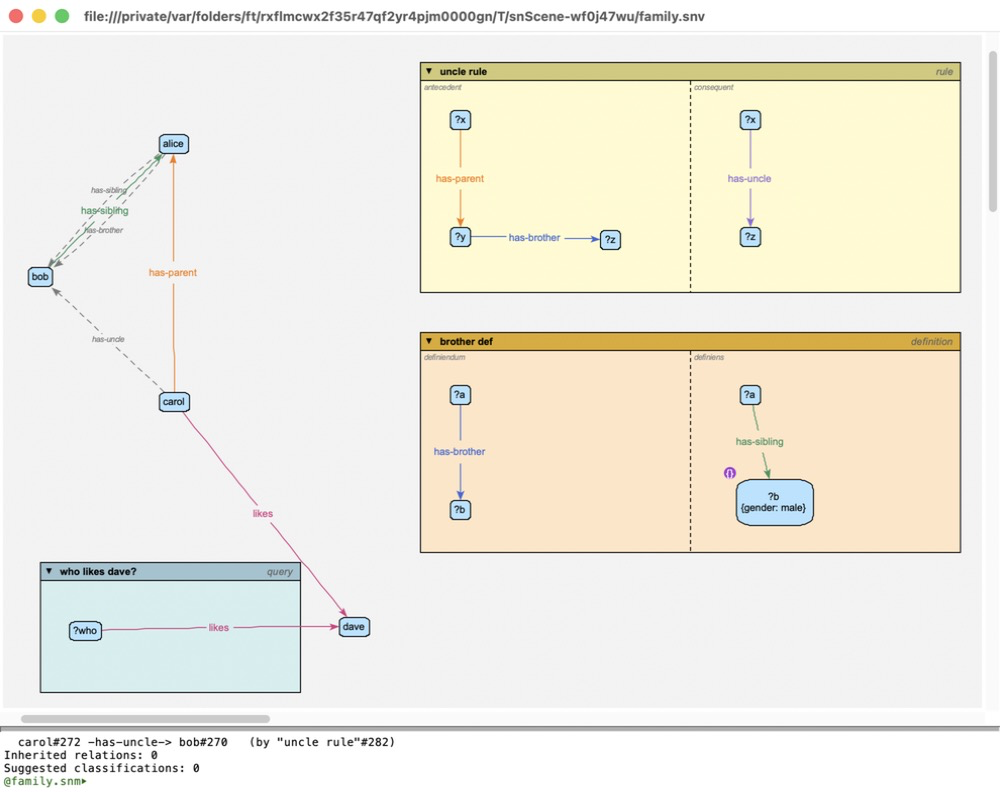

Getting Started
===============

Installing
----------

*Semantic Nets* comes as a Mac app, on a disk image. There are two:

``SemanticNets-1.0-universal.dmg``
  For any Mac: Intel Macs with macOS 10.15 (Catalina) or later, and Macs
  with Apple silicon with macOS 11 (Big Sur) or later.

``SemanticNets-1.0.dmg``
  For Macs with Apple silicon (M1 or later) only, with macOS 11 or later. It's
  the same app, but smaller.

Open the disk image, and drag **Semantic Nets** onto the **Applications**
folder beside it.

The first time you open it, macOS will refuse to open it with a double-click,
because it isn't signed by an identified Apple developer. Instead,
**Control-click** (or right-click) it in Applications, choose **Open**, and
then **Open** again in the dialog. (Or: **System Settings | Privacy &
Security | Open Anyway**.) After that it opens normally.

Starting the program
--------------------

Open **Semantic Nets** as you would any app, or double-click a model
(``.snm``) or view (``.snv``) file -- or drop one on its icon -- to open it.

- **The first time**, it puts some example models in *Documents/Semantic Nets
  Examples*, and opens them: a family, with a rule, a definition and a query
  (see :doc:`contexts`), and a small taxonomy of animals (see
  :doc:`animation`).
  **Help | Install Example Models** puts fresh copies there at any time (eg:
  those of a newer version), replacing the old ones -- and any changes you've
  made to them.
- **After that**, it reopens the windows that were open when you last quit, at
  the same size and place -- as they were last saved: changes you chose not to
  save, and the undo history, are gone. If there were none, it asks you for a
  file to open.

The **Help** menu has this guide.

The program keeps its settings in *~/.sn.xml* (see :doc:`files`), and its log
-- worth a look if something goes wrong -- in *~/Library/Logs/Semantic Nets*.

Other ways to run it
~~~~~~~~~~~~~~~~~~~~

``SemanticNets-1.0.pyz``
  The whole program in one file, for people who already have Python 3.14
  (from python.org). It needs a few more packages, installed with::

    python3.14 -m pip install clingo requests urllib3 docstring_parser

  Then run it with ``python3.14 SemanticNets-1.0.pyz [file ...]``. (If
  anything's missing, it says what.)

From the source
  With the project and its companion library *pythonUtils* checked out side
  by side (see :doc:`../developer/overview`), two scripts in the project's top
  directory start it:

  ``./sng [file ...]``
    The graphical editor, as above: a window on each file named, or else as
    when the app starts.

  ``./sn [file]``
    The terminal (text) interface only. See :doc:`terminal`.

The window
----------

Each window shows one view of one model. It has two parts:

- **The canvas**, at the top, where the network is drawn and edited.
- **The terminal pane**, below it, which shows the program's messages (eg:
  the reasoner's report) and takes typed commands (see :doc:`terminal`).

   A window on a small family model, after reasoning: the people on the left (with the reasoner's conclusions as dashed grey lines), a rule, a definition and a query in their windows on the right, and the end of the reasoner's report in the terminal pane.

Most things are done from the right-click menus: on an object for things to
do with it, and on the background for everything else. The background menu
has three submenus -- **model** (making objects, validating), **view** (what's
shown and how it's arranged) and **reasoning** -- and **Zoom**.

The menu bar has:

- **File**: **New...** (a new model, or a new view of a model), **Open...**,
  **Save view** (the view of the window you're in), **Save model** (its model),
  **Save view as...** and **Save model as...** (a copy of either: see
  :doc:`files`), and **Close model** (its model, and all the windows on it).
- **Edit**: **Model preferences...** (the window's model's own settings, eg:
  its super-models: see :doc:`files`).
- **View**: **Animation toolbar** (see :doc:`animation`).
- **Window** and **Help**.

A first network
---------------

1. **File | New...**, and give a name, eg: ``pets.snv``. This makes a model
   (``pets.snm``) and a view of it (``pets.snv``), and opens a window on them.
2. Right-click the background: **model | new subtype of Node**, and name it
   ``animal``. Do it again for ``dog``.
3. Make *dog* a kind of *animal*: right-click *dog*, **make relation to... |
   isa**, then click *animal*. (The line from *dog* follows the mouse until
   you click; **Esc** cancels.)
4. Make an individual dog: right-click *dog*, **make new instance**, and name
   it ``rex``.
5. Make a relation type: background menu, **model | new subtype of Relation**,
   and name it ``likes``. Then right-click *rex*, **make relation to... |
   likes**, and click on something rex likes.
6. Right-click the background: **reasoning | reason**. The report appears in
   the terminal pane, and what the reasoner inferred is drawn on the canvas as
   dashed grey lines.

Undo and redo are **Cmd-Z** and **Shift-Cmd-Z**; nearly everything can be
undone, including moves, layouts and edits. Each window has its own undo
history: see :doc:`terminal`.

Saving
------

**File | Save view** saves the view (positions, what's shown, ...), and **File |
Save model** the model. Models are also offered for saving when you quit
(you're asked about each one that's changed). See :doc:`files`.
