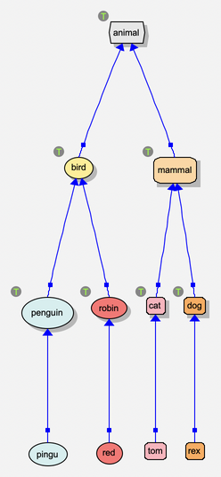
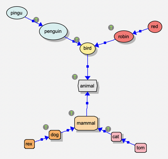
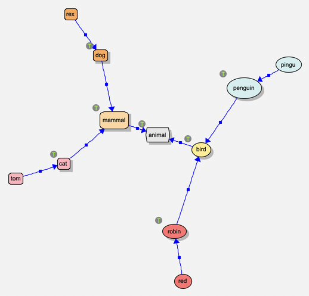
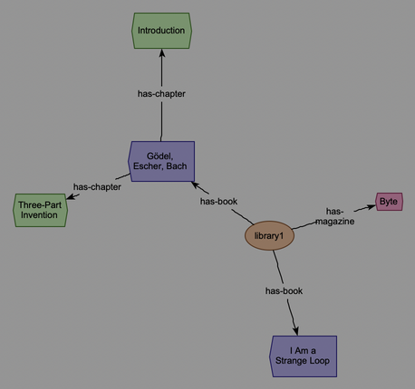

Arranging a View
================

You can put everything where you want it by dragging (see :doc:`editing`),
but the program can arrange a view for you too. The background menu's
**view | layout** has three kinds of layout:

**arrange now**
  Arrange the view once, all at once: what moves glides to its new place.
  It's one command, so **Cmd-Z** puts everything back.

**keep arranged**
  Choose the layout that keeps the view arranged *as it changes*: after
  each change (something made, shown, erased, dropped...), it arranges
  things again, as part of the same command -- so undoing the change undoes
  the rearranging too. A view has one of these at a time; the menu ticks
  it. The default, **avoid overlaps**, only finds a clear place for what's
  new, and nudges what you drop off whatever it landed on.

**animate**
  The animation layout: objects push and pull one another until they
  settle, and you watch it happen. See :doc:`animation`.

A layout with settings asks for them (its menu item ends with "..."); the
dialog offers the ones you used last time in this view. A view saves which
layout keeps it arranged, and the settings you used, with the view.

What's arranged is the nodes shown. Relations follow their ends; context
windows (rules, queries, ...) and what's in them are left as they are; and
what's hidden stays where it is.

The layouts
-----------

==================  ==========  ===========  ===================================================
layout              arrange     keep         what it does
                    now         arranged
==================  ==========  ===========  ===================================================
**tree**            yes         yes          trees by a relation type, in levels
**balloon**         yes         yes          trees, each node's children in a ring round it
**radial**          yes         yes          trees, each level on a circle round the root
**hubs**            yes         yes          the most connected nodes as hubs, the rest round them
**gather nodes**    yes                      pulls in objects that have strayed far from the rest
**avoid overlaps**              yes          (the default) places what's new, and what's dropped
**none**                        yes          leaves things where they are
==================  ==========  ===========  ===================================================

Trees
~~~~~

The **tree**, **balloon** and **radial** layouts all see the nodes as
*trees*, by a relation type: by **isa**, a type is the parent of its
subtypes and instances; by *has-parent*, a parent of their children; by
*includes*, a package of its modules. Its subtypes count too, and a node's
children are grouped by which of them they're related by (eg: a package's
modules, then its sub-packages). They ask:

**Relation**
  The relation type the trees are made of (by default, *isa*).

**The parent is the relation's**
  Which end is the parent: the **destination** for *isa* (*dog* isa
  *animal*: the parent is *animal*) and for ``has-*`` relations (*carol*
  has-parent *alice*); the **source** for relations like *includes* (a
  package includes its modules). Choosing a relation type sets this to the
  destination for *isa*, and to the source for any other: for a ``has-*``
  relation, set it back to the destination.

**Grows** (tree only)
  Which way the trees grow, from the root to the leaves: right, down, left
  or up.

**Space between neighbours**
  How far apart neighbouring nodes are kept.

**Compact** (tree only)
  Tuck subtrees in beside each other where there's room, rather than giving
  each a band of its own: smaller, for big, uneven trees.

**Nodes in no tree**
  What to do with the nodes that aren't in any tree: **leave** them where
  they are; put them in **rows** after the trees; or put each **near** what
  it's related to (and those related to nothing in rows).

**Trees related to one another** (balloon and radial only)
  What to do with a tree whose root is related -- by some other relation
  type -- to a node in another tree: **joined**, it goes out beyond that
  node, as if it were one of its children, so the trees make one drawing;
  **apart**, each tree is laid out on its own. (Eg: the XMLreader's model of
  a file, by *has-property*, is many small trees -- an object and its
  properties -- linked by *has-object*: joined, they make one tree.)
  Joining starts from the trees whose roots aren't related to another tree.
  In a view kept arranged, a joined tree's root dropped somewhere stays
  there, a tree of its own.

A node with two parents goes under the first; a relation that would make a
cycle is left out of the trees (it's still drawn).

   **tree**, by *isa*, growing down: each type above its subtypes, and the
   individuals at the bottom.

   **balloon**, by *isa*: each node's children in a ring round it, spread
   away from its parent.

   **radial**, by *isa*: the root in the middle, and each level further out,
   each subtree in its own wedge, out beyond its parent -- however big it is,
   it keeps to its parent's side, rather than spreading round the root.

Hubs
~~~~

The **hubs** layout needs no relation type: it uses every relation shown.
In each group of connected nodes, the ones with at least a given number of
relations (**A hub has at least this many relations**: 3, to start with)
are hubs, each with the nodes nearest it round it like spokes; the hubs go on
a circle, with their spokes facing out. It suits networks that aren't trees
-- eg: what the XMLreader makes of an XML file (see :doc:`exampleApps`).

   **hubs**, on the XMLreader's model of *books.xml*: the library, and each
   of its books, is a hub.

Keeping a view arranged
-----------------------

With **tree**, **balloon**, **radial** or **hubs** chosen in **keep
arranged**, the view is laid out again after each change:

- What you add (eg: **make new instance**, or **expand**) goes in its place
  in its tree, and the tree opens up to make room; what you erase or hide
  closes the gap. What's beside it moves along to suit.
- A node you **drag** takes what's under it along, and is *pinned* where you
  drop it: it's the root of a tree (or group) of its own from then on. A
  node in no tree that you drop stays where you put it.
- **arrange now** with the same layout clears the pins, and puts everything
  back in order.

Gathering and floating
----------------------

- **arrange now | gather nodes** pulls objects that have strayed far from
  the rest (eg: after a big layout, or an **expand**) back in toward them.
- **view | float all relations** puts every relation's label back midway
  between its ends (see :doc:`editing`).
- A context window's menu has **gather**: it brings what the window's
  context contains (eg: a rule's patterns, scattered by a layout) into its
  panes.

Tips
----

- For a class diagram, use **tree** by *isa*, growing **down**; for a
  family tree, **tree** by *has-parent* (the parent is the destination),
  growing down too.
- Before arranging a big view, hide what you don't need (eg: **view | hide by
  category | isa individuals**, or **relation types...**: see
  :doc:`viewing`), or erase it (**erase everything else**, on a node's menu,
  keeps just that node, or the selection).
- Programs built on *Semantic Nets* use these layouts too: eg: the
  pythonParser's views are arranged as a tree by *includes*, growing right
  (see :doc:`exampleApps`).
