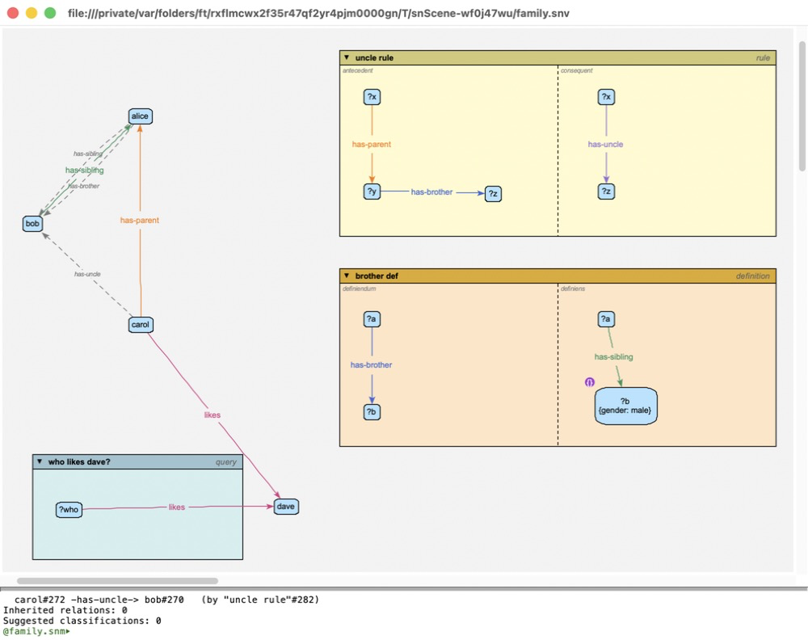

Reasoning
=========

The reasoner works out what follows from a model: what's inherited, what's
implied by relations' properties, what rules and definitions conclude -- and
what's wrong. It uses `clingo <https://potassco.org/clingo/>`_, an answer set
programming system -- or, if you choose it, `Nemo
<https://github.com/knowsys/nemo>`_, a Datalog engine that can also say *why* a
conclusion holds, `CLIPS <https://www.clipsrules.net>`_, a production rule
system, or `SWI-Prolog <https://www.swi-prolog.org>`_ (see `Engines and
explanations`_ below).

Reasoning
---------

**Reason** (▶, on the reasoning toolbar along the bottom of the window, or
**reasoning | reason** on the background menu) reasons over the window's
model; **Retract** (↺) takes what it inferred back out again. **Reason
silently** (▷, or **reasoning | reason silently**) reasons too, but doesn't
add what it infers to the views -- only the problems are marked, and only a
summary is printed: eg: so that queries find what the rules conclude without
cluttering the canvas. (Hover over a button to see what it does.) At the
toolbar's left, a small box says which reasoner engine is used (see `Engines
and explanations`_): click it to choose another, from a menu of the engines.
The toolbar also says what the last reason found -- how many relations and new objects it
inferred, and how many problems -- and, at its right, whether the model can
be edited: a pencil, crossed out in red if it can't be here. Click the pencil
(or choose **Edit | Lock view**) to lock the view, so it can't change the
model -- not even by dragging the end of an arc to another object -- but can
still be arranged (moving things, erasing them from view, layouts) and saved;
do it again to unlock it. The lock is saved with the view, and other views of
the model aren't locked. A read-only model's view (eg: the system model, or
the base rules) can't be unlocked. (**View | Reasoning toolbar** hides it, or
shows it again.) The report goes to the terminal pane, in sections:

**Violations**
  Errors and warnings: relations whose source or destination is outside their
  type's domain or range, isa cycles, an object that isa an individual,
  redundant parents, irreflexive or asymmetric relations broken, relation
  types tagged with conflicting properties, and rules the reasoner can't use.

**Inferred relations**
  Relations implied by the relational properties (symmetric, transitive,
  ...) of their types, and by nodes their links define (see
  :ref:`defining-links`).

**Rule conclusions**
  What the rules and definitions concluded: relations, attribute values,
  types, and new objects (see :doc:`contexts`).

**Inherited relations**
  Relations an individual has because one of its types has them.

**Suggested classifications**
  Types an object could be given to make a relation it's in fit its type's
  domain or range.

The results are also shown on the canvas, in every view of the model:

- inferred relations (and the relations and types rules conclude) are added
  to the model as **inferred** relations, drawn in their usual look, but
  **faded**, with **dashed** lines; inherited relations the same, with
  **dotted** lines. They're relations like any other -- they take part in
  the layouts, for example -- but they aren't saved with the model or the
  view, and adding them doesn't count as a change to either (even a
  read-only model can be reasoned over). They're the reasoner's: they can't
  be edited, removed, or related to anything -- but **mark as asserted** in
  an inferred relation's menu makes it an ordinary (asserted) part of the
  model, saved with it (not in a read-only model). It can be undone;
- attribute values rules conclude for the model's own objects (eg: from a
  definition's constraints) are added as **inferred** attributes: they're
  used like any other value, but aren't saved, and an object's own (given)
  value always wins over one inferred. If rules conclude different values
  of one attribute for an object, it gets the first rule's (in the order
  they're in the model, and then its super-models), whichever engine
  reasoned. The attribute editor shows an
  inferred value greyed out, marked **I**, with an **assert** button: press
  it, then **Save Changes**, to make it an ordinary value;
- objects with violations get a red **E** marker: hover over it for the
  problems, or choose **show error report** from the object's menu.

   After reasoning: alice *has-sibling* bob as well (*has-sibling* is symmetric); the definition concludes that alice *has-brother* bob, and that fires the uncle rule: carol *has-uncle* bob. And the requirement (see :doc:`contexts`) warns that alice and bob have siblings, but no parents: hover over their markers to see.

Inferred relations are shown only between objects that are both shown in
the view.

The results stay until you reason again or choose **reasoning | clear
reasoning** -- they aren't updated as you edit, so reason again after
changing the model. Reasoning again keeps the inferred relations that are
still inferred (where you've put them), adds new ones, and removes the
rest. Typing ``reason`` (or ``clear reasoning``) in the terminal does the
same as the button.

.. _reasoning-about:

Reasoning about some objects
~~~~~~~~~~~~~~~~~~~~~~~~~~~~

An object's menu has **reason**, **reason silently** and **retract** too:
they're about just that object -- or, if it's selected, everything selected.

- **reason** adds (and draws) what the reasoner concludes about it, and marks
  its problems; the report in the terminal pane is about it too. What's
  about an object is what it takes part in: the relations inferred to or
  from it, the types and attribute values the rules conclude for it, the new
  objects a rule makes for it (with their types and relations), and the
  violations that name it. For a relation, it's also what's inferred between
  its two ends (eg: for *bob has-sibling alice*: *alice has-sibling bob*);
  for a relation type, the relations of that type; for a rule, what it
  concludes.
- **reason silently** adds the same to the model, without drawing it, and
  marks its problems.
- **retract** takes back what's about it -- even what reasoning about
  something else brought in (eg: a relation to it) -- and its problems'
  markers. The rest stays.

The reasoner still reasons over the whole model -- what holds of one object
can depend on any of it: eg: *carol has-uncle bob* follows from *carol
has-parent alice* and *alice has-brother bob*, which is itself inferred --
it's just what's added that's chosen. Each one adds to what's there (where
it still holds: what's no longer concluded goes), and the last say wins: an
object reasoned about after another was retracted gets back what's between
them. The reasoning toolbar's summary says what's shown: eg, "about carol and
bob: inferred: 3 relations; 1 warning". A whole **reason** shows everything
again; **Retract** (↺) and **clear reasoning** take everything back. In the
terminal: ``reason carol bob`` (``--silent`` too), and ``retract carol``.

Engines and explanations
------------------------

The reasoner has four engines, which reach the same conclusions:
**clingo** (the default), **Nemo**, **CLIPS** and **Prolog** (SWI-Prolog). The
apps include clingo and Nemo; CLIPS and Prolog are installed separately (see
`Installing an engine`_, which also covers the ``.pyz`` and the source). The ``reasoner/engine`` setting
(**Settings...**, in the application menu, or the box at the left of the
reasoning toolbar) says which one **reason**, queries and ``ask reasoner``
use. (In the box's menu, an engine that isn't installed isn't chosen: it says
how to install it instead.) ``reason --engine nemo`` picks one for a single run.
``ask reasoner`` takes a question in the engine's own language: for clingo,
``'ans(X) :- holds(T,F,X), name(T,"owns"), name(F,"fred").'``; for Nemo,
``'ans(?X) :- holds(?T,?F,?X), name(?T,"owns"), name(?F,"fred").'``; for
CLIPS, ``'(defrule q (holds ?t ?f ?x) (name ?t "owns") (name ?f "fred") =>
(assert (ans ?x)))'``; for Prolog, ``'ans(X) :- name(T,"owns"), name(F,"fred"),
holds(T,F,X).'`` (its goals run in the order they're written, so start with
what narrows things down most).

What Nemo adds is explanations. An inferred relation's menu has **explain
(why it holds)**, which prints the steps to the terminal pane: the rules it
follows by (yours, and the base rules: eg, *transitive*), down to what the
model asserts. Eg::

  ann -ancestorOf-> fred
    ann -ancestorOf-> fred, by the rule "transitive"
      ann -ancestorOf-> mary (asserted)
      mary -ancestorOf-> fred (asserted)
      ancestorOf is transitive

The terminal's ``explain`` does the same for any relation, or any type and
two objects: ``explain ancestorOf ann fred`` (``--full`` for every step the
engine took). It uses Nemo whichever engine reasons.

One difference: in a rule (not a constraint or a query), Nemo and CLIPS
test a **not** attribute constraint (eg: ``not gender: female``) against the
attributes the model gives, not those other rules conclude -- they need the
rules in an order they can work through, one layer at a time.

Installing an engine
~~~~~~~~~~~~~~~~~~~~

When an engine that isn't installed is wanted -- **reason** with the
``reasoner/engine`` setting on it, **explain (why it holds)**, or the
terminal's ``explain`` -- the program says so, with a link to here. If it's
the one the setting picks, it also offers to reason with one that is
installed: this time, or from now on.

**In the apps**
  clingo and Nemo are in them. An engine an app doesn't include -- CLIPS or
  Prolog -- can be installed for a Python 3.14 on the computer -- the same
  version as the app's own, for the same kind of processor (eg: Apple
  silicon) -- and the app uses it from there::

    python3.14 -m pip install clipspy

  (on Windows, ``py -3.14 -m pip install clipspy``). For Prolog, first install
  `SWI-Prolog <https://www.swi-prolog.org/download/stable>`__ itself (9.1.12 or
  later: on a Mac, its app, or ``brew install swi-prolog``; on Windows, its
  installer, letting it add ``swipl`` to the ``PATH``; on Linux, its PPA or
  your distribution's package), then its Python interface::

    python3.14 -m pip install janus-swi

  (pip builds it against the ``swipl`` it finds on the ``PATH``, so open a new
  terminal after installing SWI-Prolog. The Mac app's ``swipl`` isn't on the
  ``PATH``: put it there for pip with ``PATH=/Applications/SWI-Prolog.app/Contents/MacOS:$PATH
  python3.14 -m pip install janus-swi``.) The program finds SWI-Prolog's files
  itself when it reasons, even when ``swipl`` isn't on the ``PATH``; if it
  can't, set the ``SWI_HOME_DIR`` environment variable to the folder that
  ``swipl --dump-runtime-variables`` gives as ``PLBASE``. If there's no Python
  3.14 on the computer yet, install one from https://www.python.org first. The app looks for that
  Python where its installers put it (python.org's, Homebrew's, ...) and on
  the ``PATH``; if it's somewhere else (eg: a virtual environment), give its
  executable as the ``reasoner/python`` setting (eg:
  ``/Users/me/venvs/sn/bin/python``).

**The** ``.pyz`` **or the source**
  Install the engine for the Python that runs the program (see
  :doc:`gettingStarted`): clingo with ``python3.14 -m pip install clingo``,
  Nemo with ``python3.14 -m pip install nemo-python``, CLIPS with::

    python3.14 -m pip install clipspy

  and Prolog, once SWI-Prolog is installed (see above), with::

    python3.14 -m pip install janus-swi

Then start the program again.

Switching rules off
-------------------

To try a model without one of its rules, definitions, constraints or
requirements, **disable** it: choose **disable** from its menu (or give it a
``disabled`` attribute that's true -- every context has one, false to start
with). The reasoner ignores it, and it's drawn with a red slash through it.
**enable** (or undo) puts it back. Reason again to see the difference.

Highlights
----------

**answer query** and **show conclusions** (see :doc:`contexts`) highlight the
objects they found. **reasoning | clear highlights** -- or **Esc** -- clears
them.

Tests and conclusions
---------------------

It's worth keeping the two roles of a pattern straight:

- a **query**, a rule's **antecedent**, and either side of a **definition**
  when it's being *matched*, only test the model: nothing in them is asserted;
- a rule's **consequent** (and a definition's other side) is *concluded* for
  each match: its relations, its variables' types and its variables'
  constraints all become conclusions.

The conclusions are added to the model, but as **inferred** objects and
attributes (see above): faded, not saved, not editable, taken away by
**Retract** (and by the next reason, once they're no longer concluded --
those still concluded are kept). The model still says only what you drew,
until you **mark as asserted** the ones you want to keep.

Validation
----------

**model | validate** (**Option-V**) is a quicker check, done without the
reasoner: it checks each object's own consistency (its attributes, its types,
its relations' ends). Its problems are shown the same way, with **E**
markers.
