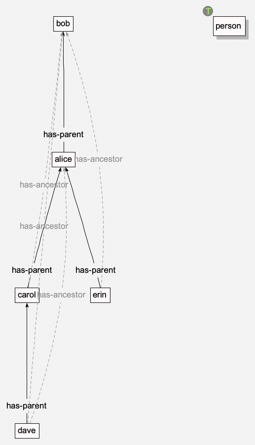

Worked Examples
===============

Three examples, each from start to finish: a family tree drawn in the
editor, a small model typed at the terminal, and finding your way round a
big model someone else made. (The examples that come with the program --
the family, with its rule, definition, query and requirement, and the
animals -- are described in :doc:`contexts` and :doc:`animation`.)

A family tree, in the editor
----------------------------

A family tree, kept arranged as you add to it, and a reasoner that works out
everyone's ancestors.

1. **File | New...**, and call it ``tree.snv``.
2. **The types.** Background menu, **model | new subtype of Node**:
   ``person``. Then **model | new subtype of Relation**: ``has-ancestor``.
   Right-click *has-ancestor* and **make new subtype**: ``has-parent``. (So
   a parent is a kind of ancestor.)
3. **Ancestry is transitive**: an ancestor's ancestor is an ancestor.
   Double-click *has-ancestor* (or **edit attributes**), **Add New
   Attribute**, call it ``transitive``, and **Save Changes**. (Any value
   will do: the tag is either there or not -- see :doc:`concepts`.) Only
   *has-ancestor* needs it: a *has-parent* relation is a *has-ancestor*
   relation too, so chains of parents give ancestors. (*has-parent* itself
   isn't transitive: a parent's parent isn't a parent.)
4. **The people.** Right-click *person*, **make new instance**: ``alice``.
   Again for ``bob``, ``carol`` and ``dave``.
5. **Keep it arranged as a tree.** Background menu, **view | layout | keep
   arranged | tree...**: Relation *has-parent*, **The parent is the
   relation's** *destination*, **Grows** *down*, **Space between
   neighbours** ``60`` (room for the labels), **Nodes in no tree** *rows*.
   **OK**.
6. **The family.** Right-click *carol*, **make relation to... |
   has-parent**, and click *alice*. Likewise *dave* has-parent *carol*,
   and *alice* has-parent *bob*. Each time, the tree rearranges itself:
   bob at the top, then alice, carol and dave, each below their parent.
7. **Reason** (▶ on the reasoning toolbar). The report, in the terminal
   pane, has three inferred relations -- *carol -has-ancestor-> bob*, *dave
   -has-ancestor-> alice* and *dave -has-ancestor-> bob* -- and they're
   drawn on the canvas, faded, with dashed lines.
8. **Add to it.** Make another person, ``erin``, and relate her to *alice*
   by *has-parent*: the tree opens up to make room for her beside carol.
   **Reason** again for her ancestors.
9. **Undo** (**Cmd-Z**) takes back one step at a time -- each relation along
   with the rearranging that came with it.

   The family tree after step 8 (with the isa links hidden, and the relation
   types erased from the view): the *has-parent* tree, and the reasoner's
   *has-ancestor* conclusions, faded and dashed.

To go further:

- Hide the reasoner's conclusions: **view | hide by category | inferred
  objects** -- or reason with **Reason silently** (▷).
- Ask who carol's descendants are with a query (see :doc:`contexts`): a
  query window holding *?d -has-ancestor-> carol*.
- Say who's male and female (a ``gender`` attribute), and define
  *has-father* and *has-mother* -- as the family example defines
  *has-brother* (see :doc:`contexts`).

A model at the terminal
-----------------------

The same kind of thing can be done by typing commands (see :doc:`terminal`):
in a window's terminal pane, or in ``./sn``, the terminal on its own. Here,
from the source's top directory, a model of pets:

.. code-block:: bash

   ./sn -m pets.snm

``assert`` says one thing at a time: ``assert`` *type* *name* makes an
object of a type (``--type`` makes a subtype, rather than an instance),
and ``assert`` *source* *relation* *destination* relates two objects:

.. code-block:: text

   assert node animal --type
   assert animal dog --type
   assert animal cat --type
   assert dog rex
   assert cat tom
   assert relation chases --type
   assert rex chases tom

Each prints what it made, eg: ``Node(rex, file:///.../pets.snm#262,
<individual>)``. Then ask about the structure: ``?`` is one level, ``*``
all the way:

.. code-block:: text

   query ? isa animal        -- dog, rex, cat, tom
   query * rex               -- rex, dog, animal, node, top
   query rex chases ?        -- tom

Attributes are set and read with ``set attribute`` and ``get attribute``
(``--type`` gives the value's type; it's a string otherwise):

.. code-block:: text

   set attribute rex age 3 --type int
   get attribute rex age     -- 3

Now a transitive relation, and some ancestry for the reasoner to work out:

.. code-block:: text

   assert relation has-ancestor --type
   set attribute has-ancestor transitive yes
   assert dog fido
   assert dog rover
   assert fido has-ancestor rex
   assert rex has-ancestor rover
   reason

``reason`` reports:

.. code-block:: text

   Violations: 0 error(s), 0 warning(s)
   Inferred relations: 1
     fido#272 -has-ancestor-> rover#274
   Rule conclusions: 0
   Inherited relations: 0
   Suggested classifications: 0

``save`` saves the model, and ``exit`` leaves. Open *pets.snm* in the
editor (**File | Open...**), **view | show | all**, and **view | layout |
arrange now | tree...** by *isa*, growing down, to see it.

Exploring a big model
---------------------

A model you didn't make can be big -- eg: what the Python parser makes of a
program (see :doc:`exampleApps`). Rather than show it all, start small and
bring in what you need:

1. Make one: eg, from the source's top directory, the parser on the
   *Semantic Nets* model package:

   .. code-block:: bash

      PYTHONPATH=src:../pythonUtils/src python3.14 -m sn.exampleApps.pythonParser src/sn/model --depth 0 --go

   It's saved next to the code, named after what it takes to be the main
   module -- here, *clingoReasoner_py.snm* and *.snv*, in *src/sn/model*
   (git ignores them). The view shows the packages and modules, as trees.
2. **Find one thing, and keep just that.** Right-click a module (eg:
   *reasoner*), **erase everything else**. It's alone in the view.
3. **Bring in what it's related to.** Its menu: **expand by relation...**:
   tick **defines →** (what it defines) and **imports →** (what it imports),
   one level. The tree it's in opens up for them.
4. **Bring in by type.** **view | show | nodes...**, tick *class*, and
   untick *and their relations to what's shown* to see just the classes; or
   **view | show | relations...** and tick *inherits-from*, to see which of
   those shown are derived from which.
5. **Hide the clutter.** **view | hide by category | relation types...**:
   tick *imports*. Or **isa individuals**, if the isa links are shown.
6. **Rearrange.** **view | layout | arrange now**: **tree...** by
   *includes*, or **hubs** to find what's most connected.
7. **Look at the code.** Hover over a class or function for its code;
   double-click it to open it in your editor (see the ``gui/editorCommand``
   setting in :doc:`files`).
8. **Save view as...** keeps this view of it, beside the full one.

Every step is a command: **Cmd-Z** takes it back if it brought in too much.
